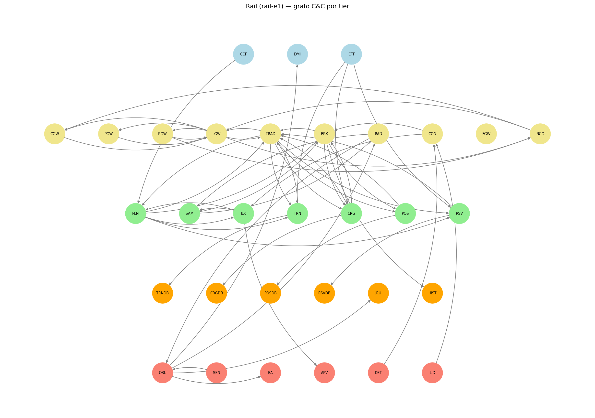
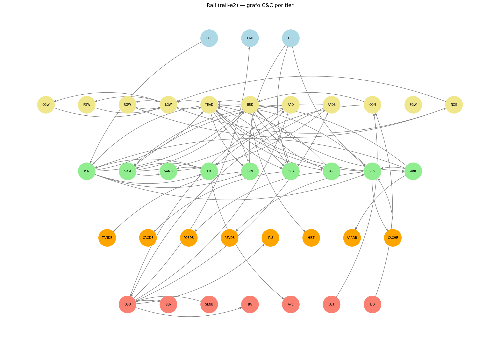
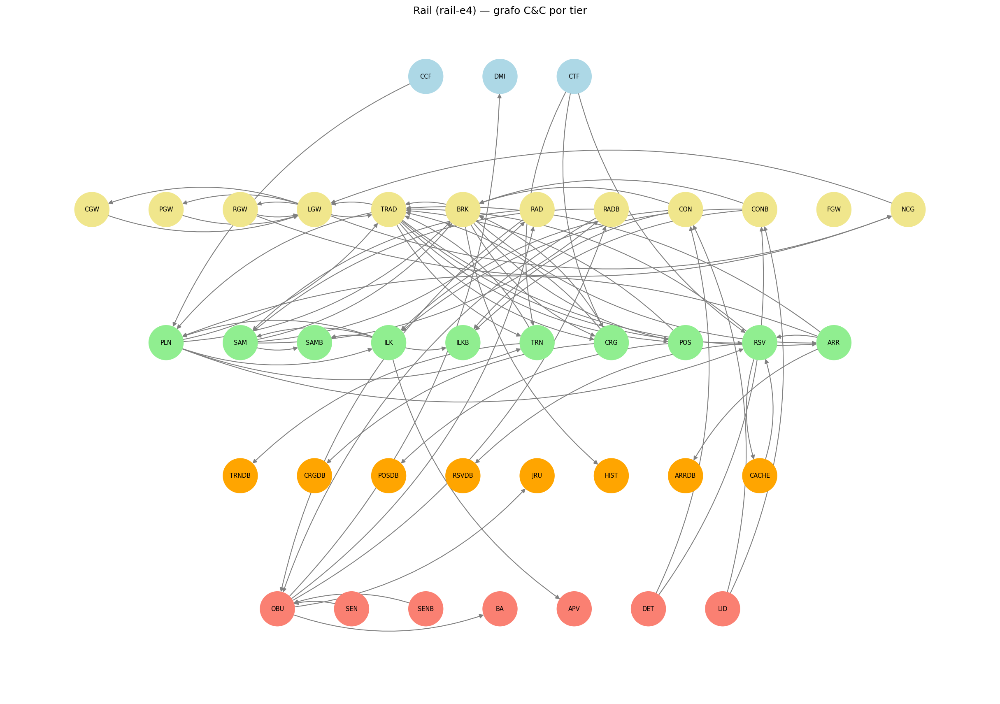

# Entrega 4. Verificación de la arquitectura del constituyente

Equipo F · Sistema de Transporte Férreo\
Arquitectura de Software a Gran Escala, 2026-II

## 1. Información del equipo

**Equipo:** F

**Miembros del equipo:**

- Cristian Daniel Montañez Pineda (cmontanez@unal.edu.co)
- Sergio Alejandro Ruiz Hurtado (seruizh@unal.edu.co)
- Juan José Medina Guerrero (jmedinagu@unal.edu.co)
- Daniel Felipe Soracipa Torres (dsoracipa@unal.edu.co)
- David Julian Guzman Cardenas (djguzmanc@unal.edu.co)
- Valeria Mora Serrano (vmoraserrano@gmail.com)
- Juan Esteban Cárdenas Huertas (juan.cardenas.huertas@gmail.com)

## 2. Sistema constituyente

**Sistema:** Sistema de Transporte Férreo (Rail Transportation System, RLS)

**Propietario:** Concesionarios férreos

**Propósito dentro del SoS:** Mueve carga en tren por los corredores en operación, entre los
puertos del Caribe y del Pacífico y las terminales férreas del interior.

## 3. Nivel global (acuerdo conjunto)

[[PENDIENTE: copiar texto final del acuerdo conjunto]]

Esta sección tiene que ser idéntica en los seis informes. Mientras se cierra el documento común,
este texto es la versión que propone el equipo F, con su fila llena. Contiene los cuatro elementos
del acuerdo conjunto (enunciado, §4.1).

### 3.1. Núcleo del lenguaje

El núcleo compartido (constituyentes, componentes de frontera, conectores globales, acuerdos y
SoS-QS1) va en la versión **v5**. Respecto de v4 (Entrega 3), v5 agrega las construcciones de
verificación del Laboratorio 5 (`capacity`, `store`, escenarios con `workload`, `fault`, `vary` y
`measure`), los escenarios y tácticas como elementos del modelo y las restricciones C12–C16, con la
misma numeración en todos los equipos. Cada equipo conserva sus restricciones C5–C11 propias
(tabla de equivalencias en la sección 4.3).

### 3.2. Modelo del SoS (`sos.arch`)

`models/sos.arch` se entrega **sin cambios** respecto de la Entrega 3:

| Elemento | Cantidad |
|----------|----------|
| Constituyentes, con su dueño | 6 |
| Componentes de frontera (T2), uno por constituyente | 6 |
| Conectores globales (SoS-K1 a SoS-K36, con sus variantes a/b) | 57 |
| Acuerdos distintos que gobiernan esos conectores | 14 |
| Análisis de SoS-QS1 (M4) | 1 |

### 3.3. SoS-QS1 bottom-up: medidas verificadas frente a presupuestos

M4: reconciliación de las 4 h ≤ 900 s después de que Carretera se recupera. Cada dueño compara la
medida verificada en su modelo con el presupuesto acordado. Clasificación del Laboratorio 5 (con
margen si el extremo alto del IC ≤ 0,9 × presupuesto).

| Tramo | Dueño | Presupuesto | Medida verificada | IC 95 % | Fuente | Resultado |
|-------|-------|-------------|-------------------|---------|--------|-----------|
| RGW: recuperación y reenvío | RTS | 200 s | Sin medida | — | Presupuesto | — |
| SoS-K5: frontera durante el reenvío | Acuerdo NCS/RTS | 40 s | Sin medida | — | Presupuesto | — |
| NCG: consolidación | NCS | 230 s | 183,8 s | [183,3; 184,3] | Documento común, §1.3.3 (ncs-e4 del equipo D) | Con margen |
| SoS-K32..K35: aviso «restablecido» | Acuerdo con el NCS | 10 s | Sin medida | — | Presupuesto | — |
| Reconciliación del Caribe (CGW) | CPS | 300 s | Sin medida | — | Presupuesto | — |
| Reconciliación del Pacífico (PGW) | PPS | 300 s | Sin medida | — | Presupuesto | — |
| Reconciliación fluvial (FGW) | FTS | 300 s | Sin medida | — | Presupuesto | — |
| **Reconciliación férrea (arribos-ms)** | **RLS** | **300 s** | **108,5 s** | **[102,9; 114,1]** | Simulación, `rail-e4` (P3, `drain` de F-QS1) | **Con margen** |
| Férrea antes del rediseño (evolución, no entra en la composición) | RLS | 300 s | 144,9 s (145,0 s [140,7; 149,3] en el reporte de `rail-e3`) | [140,7; 149,2] | Simulación, `rail-e3` | Con margen |

Notas:

- El repositorio del equipo D publica para ncs-e4 184,9 s [183,8; 186,1], no 183,8 s
  [183,3; 184,3] como el documento común. La diferencia no cambia ninguna conclusión (la holgura de
  SoS-QS1 es de más de 160 s) y se resuelve en el acuerdo.
- La medida del férreo en `rail-e4` supone que **SoS-K18a devuelve todas las unidades de un camión
  en una sola consulta** (táctica T4.3). Está por confirmar en el acuerdo; si no se confirma, la
  medida conservadora es la de `rail-e3` (144,9 s).
- El tramo del férreo es un `drain` (desde el fin de la falla hasta que sale el último trabajo
  retenido) y el del NCS es el `recovery` del Laboratorio 5, que además cuenta la espera de la
  primera llegada posterior (≈ 1/λ, 0,67 s según el equipo D). Se componen tal como están.

### 3.4. SoS-QS1 top-down: composición

Composición: 200 + 40 + NCG + 10 + máx(consumidores). Con medidas verificadas se suman los extremos
de cada IC (cota conservadora, no un IC de la suma); un tramo sin medida cuenta su presupuesto.

| Composición | NCG (alto) | máx(consumidores) | Total | Total [bajo; alto] | Umbral | Resultado |
|-------------|------------|-------------------|-------|--------------------|--------|-----------|
| Presupuestos (Entrega 2) | 230,0 s | 300,0 s | 780,0 s | [780,0; 780,0] | ≤ 900 s | Con margen |
| Medidas verificadas | 184,3 s | 300,0 s | 733,8 s | [733,3; 734,3] | ≤ 900 s | Con margen |
| NCS sin su rediseño (ncs-e2 del equipo D) | 1.944,1 s | 300,0 s | 2.482,8 s | [2.471,5; 2.494,1] | ≤ 900 s | Violada |

Con la medida de `rail-e3` en lugar de la de `rail-e4` la composición no cambia (733,8 s): el
máximo de los consumidores lo fija el presupuesto de 300 s de los demás, no el férreo.

Sensibilidad a parámetros de otros dueños (sobre el extremo alto, 734,3 s; holgura hasta violar
165,7 s y hasta perder el margen de 810 s, 75,7 s):

| Parámetro | Dueño | Valor actual | Con margen hasta | Violada por encima de |
|-----------|-------|--------------|------------------|-----------------------|
| RGW | RTS | 200,0 s (presupuesto) | 275,7 s | 365,7 s |
| SoS-K5 | Acuerdo NCS/RTS | 40,0 s (presupuesto) | 115,7 s | 205,7 s |
| NCG | NCS | 184,3 s (medida) | 260,0 s | 350,0 s |
| SoS-K32 | Acuerdo con el NCS | 10,0 s (presupuesto) | 85,7 s | 175,7 s |
| máx(consumidores) | CPS, PPS, RLS, FTS | 300,0 s | 375,7 s | 465,7 s |

SoS-QS1 M4 se verifica top-down con margen. Se viola si el NCS no aplica su rediseño (ncs-e2) o si
un tramo crece más de 165,7 s.

## 4. Lenguaje

El punto de partida es el lenguaje del equipo F de la Entrega 3 (Laboratorio 4 más C5 extendida,
C6 jerárquico y C7 gateway con capa anticorrupción), con las correcciones de la sección 4.4. Las
extensiones son **opcionales**: `sos.arch` se acepta sin cambios, y los artefactos de la Entrega 3
(`out/<modelo>/analysis.md`, `connectors.md`, `view*.mmd`) salen idénticos.

### 4.1. Extensiones para verificación

Marcas: [L5] del Laboratorio 5; [D4] del lenguaje común de la Entrega 4 (equipo D); [F] propia.

| Extensión | Marca | Sintaxis | Semántica |
|-----------|-------|----------|-----------|
| Escenarios y tácticas en el modelo | [L5, D4] | después de los `analysis` | Elementos del modelo |
| `store` de componente | [L5, D4] | `component ARRDB … store` | Retiene los trabajos mientras el siguiente componente está caído; [D4] un store caído retiene lo que recibe |
| `capacity` de componente | [F] (E3) = [L5] | `… capacity 12 load 8` | Tasa de servicio de una cola FIFO de un servidor, exponencial en la simulación |
| `load` de componente | [F] (E3) | `… load 8` | Solo para el análisis analítico de la Entrega 3; la simulación toma las llegadas de los `workload`. El reporte compara Σ tasas con `load` y avisa si difieren (en los cuatro modelos coinciden) |
| `hit` de conector | [F] | `connector F_K38a … capacity 40 hit 0.9` | Fracción en (0, 1] de las lecturas servidas a la `capacity` del conector (aciertos de caché); el resto, a la de la cola. Sin `hit`: 1 (supuesto de la Entrega 3) |
| Escenario con seis partes | [D4] | `scenario X "F-QS7" attribute … source … stimulus … artifact A, B environment … response …` | `artifact` refiere elementos del modelo |
| `verified_by`, `not_verifiable` | [D4] | `verified_by FQS7CapacityRequest` / `not_verifiable "…"` | La medida se verifica con un análisis del modelo o se declara no verificable con lo que falta |
| `workload` | [L5] | `workload W rate 8 : A -> B -> C` | Llegadas Poisson que siguen el path |
| `parallel` de conector | [F] | `connector F_K23a nature dependency coupling blocking parallel` | Dependencia bloqueante cuyos links (≥ 2, del mismo origen) se llaman a la vez: el paralelismo queda en la estructura y no solo en el workload |
| Fork/join en el path | [F] | `LGW -> TRAD -> [RSV reads CACHE \| TRN \| POS]` | Las ramas corren en paralelo y el trabajo sigue cuando termina la más lenta. Entra por un conector `parallel` |
| `Q reads S` en el path | [F] | `RSV reads CACHE` | La cola Q lee S por su dependencia bloqueante con `capacity`, a la fracción `hit` |
| `compact` | [D4] | `workload W rate r compact n : …` | Mientras un store retiene el workload, solo se guardan los últimos n |
| `fault` | [L5] | `fault ARR down at 0 for 14400` | Intervalo sin servicio; los trabajos se pierden salvo que un store los retenga |
| `vary` | [L5] | `vary ARR : 1.667, 1.25` | Varía la `capacity` de un componente o la `rate` de un workload |
| `vary hit` | [F] | `vary hit F_K38a : 1, 0.9, 0.5, 0` | Varía `hit` de un conector con `capacity` (valores en [0, 1]) |
| `measure` | [L5, D4] | `measure p99_latency W <= 800 ms`, `lost`, `recovery` | Como en el Laboratorio 5 |
| `measure drain` | [F] | `measure drain Units <= 300 s` | Desde el fin de la falla hasta que sale de su path el último trabajo que retuvo un store. A diferencia de `recovery`, no espera la primera llegada posterior (≈ 1/rate = 60 s con 1 unidad/min) |
| `run` | [L5] | `run 1800 warmup 60 replications 10` | Duración y calentamiento (s); réplicas con semillas 1..n |
| `tactic` | [D4] | `tactic T "…" for QS_F7 introduces CACHE, F_K38a changes RSV` | Ligada al escenario que la motiva y a los elementos que introduce o cambia |

Escenario A en `rail-e2`, tal como está en el modelo:

```text
scenario QS_F7 "F-QS7" attribute "rendimiento"
  source "Puertos del Caribe y del Pacífico, y Carretera"
  stimulus "8 solicitudes/s de capacidad y asignación de vagones (SoS-K3a, SoS-K7a, SoS-K24a) durante 30 min (A5)"
  artifact LGW, TRAD, RSV, TRN, POS, CACHE
  environment "Temporada de exportación de fin de año"
  response "Cada solicitud recibe confirmación o rechazo explícito"
  verified_by FQS7CapacityRequest
  workload Requests rate 8 : LGW -> TRAD -> [RSV reads CACHE | TRN | POS] -> TRAD -> LGW
  vary hit F_K38a : 1, 0.9, 0.8, 0.7, 0.6, 0.5, 0.4, 0.2, 0
  measure p99_latency Requests <= 800 ms
  run 1800 warmup 60 replications 10
```

Las seis partes de cada escenario son las de la Entrega 2. Una medida de la Entrega 2 que el
lenguaje no verifica se escribe como su propio escenario, con las seis partes del escenario padre y
`not_verifiable` (por ejemplo `QS_F7R`, «0 solicitudes sin respuesta»). Cada modelo tiene 16
escenarios.

**Programa de verificación.** `verification.py` y `simulation.py` se adaptaron del equipo D. Se
conserva su API (`run_scenario`, `interval`, `outcome` y el Monte Carlo de disponibilidad), pero
`simulate()` es un simulador de eventos discretos con `heapq` [F]: en `rail-e1` el Traductor
aparece varias veces en el mismo path, así que el barrido por orden topológico de D no aplica, y ese
barrido no tiene forks. Semillas 1..n por réplica (Monte Carlo: 1000 + i); dos corridas dan salidas
idénticas byte a byte. IC 95 % con t de Student. Resultado: con margen si el extremo desfavorable
del IC está a un 10 % del umbral; sin margen si está dentro del umbral; violada si el extremo
favorable lo excede; si no, inconclusa. Las propiedades estructurales y las de umbral 0 son
«satisfecha» o «violada».

### 4.2. Chequeo de correspondencia (C16)

`correspondence.py` se copió del lenguaje común y se le agregó `--as RLS`: el script toma el nombre
del `system` como constituyente, y nuestros modelos declaran `system Rail`, nombre que aparece en
todos los artefactos de la Entrega 3. Verifica contra `sos.arch`: K1, los componentes de frontera;
K2, la naturaleza, el acoplamiento, la información, el acuerdo y los extremos de cada conector
global; K3, que no falte ningún conector global del constituyente.

```text
$ python correspondence.py --as RLS models/sos.arch models/rail-e1.arch ... models/rail-e4.arch
models/rail-e1.arch: does NOT correspond to models/sos.arch
  K3: global connector SoS_K34 of the joint model is missing
models/rail-e2.arch: corresponds to models/sos.arch
models/rail-e3.arch: corresponds to models/sos.arch
models/rail-e4.arch: corresponds to models/sos.arch
```

La falla de `rail-e1` es la esperada: la estructura de partida es anterior al acuerdo v4, que
agregó SoS-K34. Se reporta y no se corrige, porque e1 es el punto de partida de la iteración 1.

### 4.3. Restricciones y equivalencia con el lenguaje común

| Equipo F | Lenguaje común | Contenido |
|----------|----------------|-----------|
| C1–C4 | C1–C4 (Laboratorio 4; D corrigió C3 y adaptó C4) | Laboratorio 4, sin cambio en F |
| C5 [F, extendida] | C5 (extensiones de D, A y C) | Entrega 3 más las reglas de `hit`, `reads`, colas, `drain`, `parallel` y forks (tabla siguiente) |
| C6 [F] jerárquico | C6 [D] capas: **distinta** | Una sola fuente de comandos por destino, hacia abajo, sin ciclos. Se conserva |
| C7 [F] gateway + ACL | C8 [A] (cruce entre T2), parecida; C7 [D] no se adopta | Solo el gateway cruza la frontera y su vecino interno es el traductor. Se conserva |
| — | C9–C11 (A, C) | Alcance CPS y RTS: no aplica |
| C12 | C12 (= C6 del Laboratorio 5) | Cada salto de un workload sigue un conector (en cualquier sentido); en un fork, cada par (paso anterior, rama) y (rama, paso siguiente) |
| C13 | C13 (= C7 del Laboratorio 5) | Una falla solo en un componente con `capacity` |
| C14 | C14 | Seis partes; la medida se simula (workloads, measures y run), se verifica con `verified_by` o se declara `not_verifiable`. [F] además: al menos 2 réplicas y calentamiento menor que la corrida |
| C15 | C15 | La táctica introduce o cambia elementos y la motiva un escenario verificado. Por eso la táctica «canónico v1/v2» de F-QS6 no se declara |
| C16 | C16 | Correspondencia con `sos.arch` (`correspondence.py --as RLS`) |

Modelos mal formados nuevos de la Entrega 4 (`invalid/`, generados con `tools/make_invalid.py`;
mensajes en `invalid/expected-rejections.txt`):

| Modelo | Restricción | Mensaje |
|--------|-------------|---------|
| `c12-hop.arch` | C12 | `X12: X12Jobs goes from RSV to LGW without a connector` |
| `c13-fault.arch` | C13 | `X13: fault on TRAD, which has no capacity` |
| `c14-parts.arch` | C14 | `X14: quality scenario without environment` |
| `c14-run.arch` | C14 | `X14R: a simulated scenario needs at least one measure and its run` |
| `c14-replications.arch` | C14 [F] | `X14N: a simulated scenario needs at least 2 replications for its confidence interval` |
| `c14-warmup.arch` | C14 [F] | `X14W: warmup 600 s is not below the run duration 600 s` |
| `c15-tactic.arch` | C15 | `X15T: motivated by X15, whose measure is not verified` |
| `c5-hit-capacity.arch` | C5 `hit` | `F_K22: hit applies only to a connector with capacity` |
| `c5-hit-range.arch` | C5 `hit` | `F_K22x: hit 0 is not in (0, 1]` |
| `c5-vary-hit.arch` | C5 `vary hit` | `X5V: vary hit on F_K22, which is not a connector with capacity` |
| `c5-reads-queue.arch` | C5 `reads` | `X5R: X5RJobs: TRN reads TRNDB: TRN is not a queue` |
| `c5-queue-twice.arch` | C5 cola | `X5Q: X5QJobs goes through the queue RSV more than once` |
| `c5-drain-store.arch` | C5 `drain` | `X5D: drain on X5DJobs, whose path has no store` |
| `c5-drain-fault.arch` | C5 `drain` | `X5F: drain needs a fault in the scenario` |
| `c5-drain-order.arch` | C5 `drain` (store antes de la falla) | `X5O: drain on X5OJobs: no store at or before the failing component (RSV) in its path, so no job is held` |
| `c5-parallel-kind.arch` | C5 `parallel` (a) | `F_K23b: parallel applies only to a blocking dependency` |
| `c5-parallel-links.arch` | C5 `parallel` (b) | `F_K3: a parallel connector needs at least two links, it has 1` |
| `c5-parallel-source.arch` | C5 `parallel` (c) | `F_K22: the links of a parallel connector leave one source, not ['CRG', 'POS', 'RSV', 'TRN']` |
| `c5-fork-parallel.arch` | C5 fork | `X5P: X5PJobs: the fork [RSV \| TRN \| POS] after TRAD is not entered through a parallel connector with a link to each branch` |
| `c5-parallel-sequence.arch` | C5 fork | `X5S: X5SJobs visits RSV, CRG, targets of the parallel connector F_K2p, in sequence; they are a fork` |

Los rechazos de la Entrega 3 y de las correcciones posteriores conservan su mensaje (32 modelos en
total en `invalid/`).

### 4.4. Correcciones de la Entrega 3

El detalle está en `CORRECCIONES-E3.md`.

| Feedback del profesor | Respuesta |
|-----------------------|-----------|
| (a) F-QS7: la caché no entraba en la cadena; su efecto estaba escrito a mano en reservas-ms | reservas-ms vuelve a `capacity 12 load 8`; la tasa de 40/s (A7) pasa a la dependencia de lectura F-K38a; nuevo factor `RSV reads CACHE`. La cifra analítica no cambia (215 ms). En esta entrega el acierto de la caché (`hit`) deja de ser un supuesto implícito y se analiza su sensibilidad (sección 7.2) |
| (b) F-QS2: `latency 1200` precalculado (3 × 400) | Métrica `detection` y propiedad `misses`, como en el común: F-K11 pasa a `period 400 misses 3` y la detección (1500 ms) se calcula. Con `detection` se agregó la toma de control del SAM (F-QS5): 2500 ms ≤ 5000 ms |

## 5. Propiedades

Clases: E = estructural, RA = respuesta acotada, S = seguridad («nada malo pasa»),
R = recuperación, P = probabilística. Técnicas: G = grafo (networkx); SIM = simulación de eventos
discretos (réplicas, semillas 1..n, IC 95 %); MC = Monte Carlo de fallas y reparaciones (1000
réplicas × 20 años, MTTR 4 h); AN = analítico de la Entrega 3 (`transformations.py`, valor
puntual).

| ID | Propiedad | Escenario | Atributo | Clase | Técnica | Umbral |
|----|-----------|-----------|----------|-------|---------|--------|
| S1 | Sin punto único de falla en la cadena de autorización C1 (OBU incluida; se informa aparte la cadena de tierra) | F-QS5 | Disponibilidad | E | G | 0 elementos |
| S2 | Sin conector bloqueante en el ciclo de autorización | F-QS4 | Seguridad / rendimiento | E | G | 0 elementos |
| S3 | Todo suministro hacia un T3 de la cadena de autorización declara `period` | F-QS2, F-QS5 | Disponibilidad | E | G | 0 elementos |
| S4 | SoS-K34 alcanza arribos-ms y un `store` retiene las unidades antes del componente que falla en F-QS1 | F-QS1, SoS-QS1 | Resiliencia | E | G | Camino y store |
| P1 | p99 de la solicitud de capacidad, 8 sol/s | **F-QS7 (A)** | Rendimiento | RA | SIM + `vary hit` | ≤ 800 ms |
| P2 | p99 de la custodia carga-ms → gateway durante la ráfaga | F-QS3 | Rendimiento | RA | SIM | ≤ 500 ms |
| P3 | Reconciliación (`drain`) tras la caída de 4 h | **F-QS1 (B)** → SoS-QS1 M4 | Resiliencia | R | SIM + `vary ARR` | ≤ 300 s |
| P4 | Unidades perdidas en la caída | F-QS1 | Resiliencia | S | SIM | 0 |
| P5 | Detección de datos viejos (3 × 60 s) | F-QS1 | Resiliencia | RA | AN (`detection`) | ≤ 240 s |
| P6 | Disponibilidad de la cadena C1 | F-QS5 | Disponibilidad | P | MC (Lab 3 como conocido) | ≥ 99,95 % |
| P7 | Disponibilidad de C1 con la vía (ILK, CON) | F-QS5 | Disponibilidad | P | MC + sensibilidad a β | ≥ 99,95 % |
| P8 | Toma de control de SAM-B | F-QS5 | Disponibilidad | RA | AN (`detection`) | ≤ 5000 ms |
| P9 | Detección del concentrador callado | F-QS2 | Tolerancia a fallas | RA | AN (`detection`) | ≤ 2000 ms |
| P9b | Detección del estado de rutas callado (desde la it. 4) | F-QS2 | Tolerancia a fallas | RA | AN (`detection`) | ≤ 2000 ms |
| P10 | Ciclo de autorización p99 | F-QS4 | Seguridad (tiempo) | RA | AN (Boole) | ≤ 1000 ms |
| P11 | SoS-QS1 M4 compuesto, con P3 bottom-up | SoS-QS1 | Resiliencia | RA | AN (presupuestos) + composición con medidas verificadas | ≤ 900 s |

**Mínimos del enunciado.** Estructurales: S1–S4. Simulación con atributos distintos: P1/P2
(rendimiento), P3/P4 (resiliencia) y P6/P7 (disponibilidad, Monte Carlo). Contribución a SoS-QS1:
P3 → P11. Sensibilidad: P1 (`hit`), P3 (tasa de consultas q) y P7 (β).

**Decisiones de alcance.**

- **Margen en disponibilidad.** La regla del 10 % del Laboratorio 5 se aplica a la medida, que es la
  indisponibilidad: con umbral 99,95 % (0,05 % permitido), «con margen» exige que el extremo bajo
  del IC sea ≥ 99,955 %. El equipo D usa un margen absoluto de 0,02 pp (≥ 99,97 %); con ese criterio
  P7 en e4 quedaría «sin margen».
- **El Monte Carlo clasifica la disponibilidad.** La fórmula del Laboratorio 3 es el resultado
  conocido contra el que se chequea, no el veredicto.
- **S1 incluye la OBU**, como el Laboratorio 5. Se informa además la cadena de tierra.

### 5.1. Escenarios de A y B (seis partes, Entrega 2)

| Parte | F-QS7 (A) | F-QS1 (B) |
|-------|-----------|-----------|
| Fuente | Puertos del Caribe y del Pacífico, y Carretera | Proveedor de nube de Carretera; el estímulo llega propagado por Coordinación Nacional |
| Estímulo | 8 solicitudes/s de capacidad y asignación de vagones (SoS-K3a, SoS-K7a, SoS-K24a) durante 30 min (A5) | Las posiciones de los camiones con destino a terminales férreas dejan de actualizarse en SoS-K18b durante 4 h |
| Artefacto | Rail Gateway, Traductor, reservas-ms, trenes-ms y posicion-ms (cadena C4); el modelo agrega CACHE | Planificación y despacho, reservas-ms, carga-ms y Rail Gateway; el modelo agrega arribos-ms y arribos-db |
| Entorno | Temporada de exportación de fin de año | Pico del 1 de diciembre: 40 camiones/h hacia las terminales (A3); modo degradado |
| Respuesta | Cada solicitud recibe confirmación o rechazo explícito | Detecta la degradación, baja sus consultas a la tasa acordada, planifica con la ETA estimada más 30 min y, al volver el servicio, reconcilia custodia y reservas |
| Medida | p99 ≤ 800 ms en el Rail Gateway (P1); 0 sin respuesta (no verificable) | Reconciliación ≤ 300 s (P3); detección ≤ 240 s (P5); 0 trenes cancelados y ≤ 2 consultas/s (no verificables); 0 unidades perdidas (P4, derivada de «reconcilia») |

### 5.2. Escenarios y medidas no verificables

Se declaran en el modelo con `not_verifiable` (C14).

| Escenario / medida | Qué faltaría |
|--------------------|--------------|
| F-QS1 en `rail-e1` | La estructura de partida no tiene arribos-ms, arribos-db ni SoS-K34: no hay detección ni reconciliación que analizar |
| F-QS1 en `rail-e2` | Los parámetros que la Entrega 2 diseñó y e2 no escribe: `capacity` de arribos-ms, `store` en arribos-db y cadencia de F-K28b. Se agregan en `rail-e3` |
| F-QS1: «0 trenes cancelados» y SoS-QS1 M1 | Reglas de comportamiento (despacho con la ETA estimada más 30 min) y *model checking* de la máquina de estados del despacho |
| F-QS1: «≤ 2 consultas/s por SoS-K18a» | Un limitador de tasa por conector como restricción; en la simulación la tasa es un parámetro de entrada |
| F-QS2: «0 rutas sobre estado de más de 2 s» | Máquina de estados del enclavamiento (edad del estado por sección) y *model checking* |
| F-QS3: cola de telemetría (30.600 eventos, ~160 s) | Tasas que cambian en el tiempo (ráfaga y luego carga normal) y canales con prioridad en el broker |
| F-QS4: «0 autoridades o reportes falsos aceptados» | Identidad, credenciales y límites de confianza por conector; *model checking* del protocolo de autenticación |
| F-QS6: componentes tocados por la v2 del canónico | Versiones de interfaz por conector, convivencia y comparación de dos modelos (*change impact*). C7 da evidencia parcial: todo pasa por el Traductor |
| F-QS7: «0 solicitudes sin respuesta» (timeout de 300 ms + 1 reintento) | Timeouts y reintentos en el `workload`. Medida parcial posible: fracción con latencia > 300 ms |
| SoS-QS1 M2 (error de ETA ≤ ±30 min p95) | Distribución del error de estimación de la ETA y su simulación |

## 6. Iteraciones

Un modelo por iteración, con su reporte en `out/<modelo>/verification.md` y su grafo C&C por tier
en `out/<modelo>/graph.png`.

| It. | Modelo | Contenido | Tácticas | Actividad |
|-----|--------|-----------|----------|-----------|
| 1 | `rail-e1.arch` | 32 componentes, 49 conectores, 16 escenarios | 0 | Verificar A (P1) |
| 2 | `rail-e2.arch` | 38 componentes, 64 conectores, 16 escenarios | 8 | A de nuevo con las tácticas de la Entrega 2; efectos colaterales |
| 3 | `rail-e3.arch` | Igual a e2 (38, 64), más los parámetros de B | 9 | Verificar B (P3, P4, P5), S4 y P11 |
| 4 | `rail-e4.arch` | 40 componentes, 68 conectores (rediseño) | 12 | Todas las propiedades de nuevo |

Los conteos de componentes incluyen los cinco gateways de los otros constituyentes.

### 6.1. Iteración 1: estructura de partida

**Cambio al modelo.** A `rail-e1` se le agregan los escenarios; la estructura no cambia y no se
declara ninguna táctica. F-K23a no es `parallel`, así que el escenario A recorre los tres servicios
en serie:

```text
workload Requests rate 8 : LGW -> TRAD -> RSV -> TRAD -> TRN -> TRAD -> POS -> TRAD -> LGW
```

F-QS3 simula la ráfaga completa sobre el broker único (custodia 1/s más 244 eventos/s, 20 réplicas).
F-QS1 es no verificable (sección 5.2).



*Figura 6.1. Grafo C&C por tier de `rail-e1` (estructura de partida).*

| Propiedad | Estimación | IC 95 % | Umbral | Resultado |
|-----------|------------|---------|--------|-----------|
| **P1 (A)** | 1307,5 ms | [1236,2; 1378,8] | ≤ 800 ms | **Violada** |
| P2 | 919,7 ms | [808,1; 1031,2] | ≤ 500 ms | Violada |
| S1 | CON, ILK, OBU, RAD, SAM, SEN | — | 0 | Violada |
| S2 | Ninguno | — | 0 | Satisfecha |
| S3 | F-K7 → SAM; F-K11 → ILK | — | 0 | Violada |
| S4 | Faltan SoS-K34, arribos-ms y el escenario simulado | — | Camino y store | No evaluable |
| P3, P4, P5 | — | — | — | No aplica (F-QS1 no verificable) |
| P6 | 99,7911 % | [99,7891; 99,7931] | ≥ 99,95 % | Violada |
| P7 | 99,6808 % | [99,6784; 99,6832] | ≥ 99,95 % | Violada |
| P8 | — | — | ≤ 5000 ms | No aplica (no hay SAM-B) |
| P9 | No acotada (F-K11 sin cadencia) | — | ≤ 2000 ms | Violada |
| P10 | 740 ms | — | ≤ 1000 ms | Con margen |
| P11 | No acotada (el férreo no reconcilia) | — | ≤ 900 s | Violada |

**Decisión de diseño que soporta.** P1 está violada con el IC entero por encima del umbral. La cola
de reservas-ms a 12/s con 8 sol/s (ρ = 0,67) ya da ln(100)/4 ≈ 1151 ms al p99, y los tres servicios
en serie suman sus constantes; ningún ajuste de la cola cumple sin cambiar la estructura. Esto
respalda las dos tácticas de la Entrega 2 para F-QS7: **caché de capacidad** (leer la capacidad
calculada a 40/s) y **llamadas en paralelo** a reservas, trenes y posición.

### 6.2. Iteración 2: estructura resultante, escenario A de nuevo

**Cambio al modelo.** `rail-e2` declara F-K23a como `parallel` y el escenario A usa el fork con la
lectura de la caché y `vary hit F_K38a : 1, 0.9, 0.8, 0.7, 0.6, 0.5, 0.4, 0.2, 0` (path en la
sección 4.1). Se declaran las ocho tácticas de la Entrega 2: T_Cache, T_Parallel,
T_CriticalChannel, T_Heartbeat, T_Authentication, T_RadioB, T_SensorsB y T_SAMB. F-QS3 simula solo
el canal crítico del broker (50 eventos/s, custodia 1/s más lecturas de acceso 10/s); la ráfaga va
al canal de telemetría, que no se modela (sección 9.1). F-QS1 sigue no verificable (faltan sus
parámetros).



*Figura 6.2. Grafo C&C por tier de `rail-e2` (estructura resultante de la Entrega 2).*

| Propiedad | Estimación | IC 95 % | Umbral | Resultado |
|-----------|------------|---------|--------|-----------|
| **P1 (A), hit = 1** | 204,5 ms | [203,1; 205,9] | ≤ 800 ms | **Con margen** |
| P2 (colateral) | 204,0 ms | [194,6; 213,4] | ≤ 500 ms | Con margen |
| P6 | 99,9701 % | [99,9694; 99,9708] | ≥ 99,95 % | Con margen |
| P7 | 99,8581 % | [99,8565; 99,8597] | ≥ 99,95 % | Violada |
| P8 | 2500 ms | — | ≤ 5000 ms | Con margen |
| P9 | 1500 ms | — | ≤ 2000 ms | Con margen |
| P10 | 780 ms | — | ≤ 1000 ms | Con margen |
| P11 | 780 s (presupuestos) | — | ≤ 900 s | Con margen |
| S1 | CON, ILK, OBU | — | 0 | Violada |
| S2 | Ninguno | — | 0 | Satisfecha |
| S3 | F-K7 → SAM; F-K37 → SAM-B | — | 0 | Violada |
| S4 | Falta la `capacity` de ARR y el escenario simulado | — | Camino y store | No evaluable |

Contribución de cada táctica de la Entrega 2 a P1 (`tactics_check.py`, mismas semillas):

| Estructura | Estimación | IC 95 % | Conocido | Resultado |
|------------|------------|---------|----------|-----------|
| e2: caché + paralelo (hit 1) | 204,5 ms | [203,1; 205,9] | 203,9 ms | Con margen |
| Sin caché (hit 0), con paralelo | 1275,2 ms | [1185,7; 1364,8] | 1211,3 ms | Violada |
| Con caché, sin paralelo | 304,5 ms | [303,1; 305,9] | 303,9 ms | Con margen |
| Sin caché ni paralelo (≈ e1) | 1375,2 ms | [1285,7; 1464,8] | 1311,3 ms | Violada |

**Efectos colaterales.**

- La autenticación de F-K13a/b sube el ciclo de autorización de 740 a 780 ms: P10 sigue con margen.
- El canal crítico lleva P2 de 919,7 a 204,0 ms.
- La táctica SAM-B introdujo F-K37 (estado de rutas hacia el respaldo) **sin cadencia**: S3 sigue
  violada, ahora por F-K7 y F-K37. La táctica de F-QS5 abrió un silencio no detectable en el
  respaldo.
- Las réplicas de la Entrega 2 cumplen P6 con margen, pero con la vía (P7) la cadena queda en
  99,8581 %: el concentrador aporta el 71 % de la indisponibilidad restante. S1 queda con ILK, CON
  y la OBU.

**Decisión de diseño que soporta.** La caché es la táctica decisiva para A: sin ella P1 se viola
aun con paralelo (1275,2 ms); el paralelo solo aporta unos 100 ms (304,5 → 204,5 ms). Se mantienen
las dos. Quedan para el rediseño P7 violada y S1 (redundancia de la vía) y S3 (cadencia de F-K7 y
F-K37).

### 6.3. Iteración 3: otro atributo, escenario B (F-QS1)

**Cambio al modelo.** `rail-e3` tiene **la misma estructura** que `rail-e2` (lo dice su cabecera).
Agrega los parámetros de la Entrega 2 que faltaban para B, la táctica T_Degraded (modo degradado
con reconciliación y límite de consultas) y el escenario `QS_F1` simulado:

- arribos-ms (ARR): `capacity 1.667 load 0.016667`. ARR es un servidor agregado de tasa
  1/(1/q + 0,1 s), con q = 2 consultas/s por SoS-K18a y 0,1 s de actualización local por unidad
  (A9); llegadas: 240 unidades en 4 h (A3);
- arribos-db (ARRDB): `store`;
- F-K28b: `period 60000 misses 3`, y el análisis FQS1StaleData (P5);
- `workload Units rate 0.016667 : ARRDB -> ARR -> TRAD -> LGW`, `fault ARR down at 0 for 14400`,
  `vary ARR : 1.667, 1.25, 1.0, 0.909, 0.85`, `measure drain Units <= 300 s`,
  `measure lost Units <= 0 events`, 20 réplicas.

El grafo es el de `rail-e2` (`out/rail-e3/graph.png`, idéntico en estructura).

| Propiedad | Estimación | IC 95 % | Umbral | Resultado |
|-----------|------------|---------|--------|-----------|
| **P3 (B)**, q = 2/s | 145,0 s | [140,7; 149,3] | ≤ 300 s | **Con margen** |
| P4 | 0 unidades | [0; 0] | 0 | Satisfecha |
| P5 | 180 s (3 × 60 s) | — | ≤ 240 s | Con margen |
| S4 | Camino NCG → LGW → TRAD → ARR; ARRDB justo antes de ARR | — | Camino y store | Satisfecha |
| P11 bottom-up | P3 = 145,0 s [140,7; 149,3] frente a 300 s | — | ≤ 300 s | Con margen |
| P11 (presupuestos) | 780 s | — | ≤ 900 s | Con margen |
| P1, P2, P6–P10, S1–S3 | Iguales a la iteración 2 (misma estructura y semillas) | — | — | P7, S1 y S3 violadas |

**Decisión de diseño que soporta.** El modo degradado de la Entrega 2 (guardar las unidades
pendientes en arribos-db y reconciliar con ≤ 2 consultas/s) cumple el presupuesto de 300 s con
margen y no pierde unidades. El margen depende de la tasa efectiva de consultas: con un reintento
por consulta (q = 1/s) P3 queda sin margen, 265,8 s [257,9; 273,7] (sección 7.2). Eso motiva T4.3.

### 6.4. Iteración 4: rediseño

**Cambio al modelo.** `rail-e4` parte de `rail-e3` y declara tres tácticas nuevas (12 en total):

| Hallazgo (it. 2–3) | Estado | Táctica | Introduce / cambia | Resultado en e4 |
|--------------------|--------|---------|--------------------|-----------------|
| P7: 99,8581 %; el concentrador aporta el 71 % | Violada | **T4.1** Concentrador B y enclavamiento B en espera caliente (β = 0,10) | Introduce CONB, ILKB, F-K9b, F-K10b, F-K11b, F-K40; cambia ILK, F-K11, F-K12 | P7 = 99,9581 %, con margen |
| S1: ILK y CON únicos | Violada | T4.1 | Ídem | Cadena de tierra sin puntos únicos; queda la OBU |
| S3: F-K7 y F-K37 sin cadencia | Violada | **T4.2** Latido del estado de rutas hacia SAM y SAM-B (`period 400 misses 3`) | Cambia ILK, F-K7, F-K37; análisis nuevo FQS2Routes | S3 satisfecha; P9b = 1320 ms |
| P3 sin margen si cada consulta se reintenta | Sin margen | **T4.3** Reconciliación por camión: una consulta por SoS-K18a devuelve las unidades del camión; 160 trabajos en lugar de 240 | Cambia ARR (`capacity 1.538 load 0.011111`), F-K28a; workload `Trucks` | P3 = 108,5 s; con margen también con q = 1/s |
| P1 depende de `hit` | Supuesto | T4.4 (no modelada) Precálculo de la caché tras cada reserva o cambio de surco (F-K39) | Solo comportamiento: no cambia la estructura | Se declara el supuesto hit ≥ 0,9 (sección 9.2) |

T4.1 y nuestra C6: los aparatos de vía no pueden recibir comandos de ILK y de ILKB. Se aplica la
convención del componente activo, como con el SAM en la Entrega 3: ILK representa al enclavamiento
activo en F-K5, F-K6, F-K7, F-K8 y F-K37, e ILKB solo recibe estado (F-K11, F-K11b, F-K40). El
modelo pasa C1–C15 y C16. Con T4.3, ARR atiende un camión por consulta:
1/(1/q + 1,5 × 0,1 s) = 1,538 camiones/s, con 1,5 unidades por camión (240/160, A3).



*Figura 6.3. Grafo C&C por tier de `rail-e4` (rediseño): CONB e ILKB en espera caliente.*

| Propiedad | Estimación | IC 95 % | Umbral | Resultado |
|-----------|------------|---------|--------|-----------|
| P1, hit = 1 | 204,5 ms | [203,1; 205,9] | ≤ 800 ms | Con margen |
| P2 | 204,0 ms | [194,6; 213,4] | ≤ 500 ms | Con margen |
| P3, q = 2/s | 108,5 s | [102,9; 114,1] | ≤ 300 s | Con margen |
| P3, q = 1/s (un reintento por consulta) | 191,7 s | [181,8; 201,7] | ≤ 300 s | Con margen |
| P4 | 0 camiones (0 unidades) | [0; 0] | 0 | Satisfecha |
| P5 | 180 s | — | ≤ 240 s | Con margen |
| P6 | 99,9701 % | [99,9694; 99,9708] | ≥ 99,95 % | Con margen |
| **P7** | **99,9581 %** | **[99,9572; 99,9590]** | ≥ 99,95 % | **Con margen** |
| P8 | 2500 ms | — | ≤ 5000 ms | Con margen |
| P9 | 1500 ms | — | ≤ 2000 ms | Con margen |
| P9b | 1320 ms (3 × 400 + 120 del SAM) | — | ≤ 2000 ms | Con margen |
| P10 | 780 ms | — | ≤ 1000 ms | Con margen |
| P11 bottom-up | P3 = 108,5 s [102,9; 114,1] frente a 300 s | — | ≤ 300 s | Con margen |
| P11 compuesta | 733,8 s [733,3; 734,3] (sección 3.4) | — | ≤ 900 s | Con margen |
| S1 (con OBU) | OBU | — | 0 | Violada (riesgo residual aceptado) |
| S1 (cadena de tierra, informativo) | Ninguno | — | 0 | Satisfecha |
| S2 | Ninguno | — | 0 | Satisfecha |
| S3 | Ninguno | — | 0 | Satisfecha |
| S4 | Camino NCG → LGW → TRAD → ARR; ARRDB antes de ARR | — | Camino y store | Satisfecha |
| C16 | Corresponde | — | — | Satisfecha |

Contribución de T4.1 a P7 (`tactics_check.py`, semilla 1001 en todas las variantes):

| Estructura | Estimación | IC 95 % | Conocido (Lab 3) | Resultado |
|------------|------------|---------|------------------|-----------|
| e3: sin T4.1 (ILK y CON únicos) | 99,8581 % | [99,8565; 99,8597] | 99,8599 % | Violada |
| Solo CONB | 99,9491 % | [99,9481; 99,9501] | 99,9498 % | Inconclusa |
| Solo ILKB | 99,8682 % | [99,8667; 99,8698] | 99,8689 % | Violada |
| e4: CONB + ILKB | 99,9581 % | [99,9572; 99,9590] | 99,9588 % | Con margen |

**Decisión de diseño que soporta.** T4.1 necesita las dos unidades: solo con el concentrador B la
cadena queda inconclusa (el IC cruza 99,95 %) y solo con el enclavamiento B sigue violada; con
ambas P7 se cumple con margen. T4.2 cierra el silencio de F-K7 y F-K37 y la detección queda en
1320 ms. T4.3 baja la reconciliación de 145,0 a 108,5 s y conserva el margen aun con un reintento
por consulta. Todas las propiedades verificables quedan satisfechas, salvo S1 por la OBU, que se
acepta (sección 9.2).

## 7. Chequeo y sensibilidad

### 7.1. Chequeo contra resultados conocidos (Laboratorio 5, §4.6)

| Caso | Fórmula | Conocido | Simulado | IC 95 % | ¿En el IC? |
|------|---------|----------|----------|---------|------------|
| P1 e1: M/M/1 12/8 + constantes | ln(100)/(12 − 8) + 160 ms | 1311,3 ms | 1307,5 ms | [1236,2; 1378,8] | Sí |
| P1 e2, hit = 1: fork con una sola cola | ln(100)/(40 − 8) + 60 ms | 203,9 ms | 204,5 ms | [203,1; 205,9] | Sí |
| P1 e2, hit = 0 | ln(100)/(12 − 8) + 60 ms | 1211,3 ms | 1275,2 ms | [1185,7; 1364,8] | Sí |
| P2 e1 | ln(100)/(250 − 245) + 85 ms | 1006,0 ms | 919,7 ms | [808,1; 1031,2] | Sí |
| P2 e2 | ln(100)/(50 − 11) + 85 ms | 203,1 ms | 204,0 ms | [194,6; 213,4] | Sí |
| P3 e3 (exacto) | E[N]/μ = 240,005/1,667 + constantes | 144,0 s | 145,0 s | [140,7; 149,3] | Sí |
| P3 e3 (período ocupado, L5) | E[N]/(μ − λ) | 145,5 s | 145,0 s | [140,7; 149,3] | Sí |
| P3 e4 (exacto) | E[N]/μ = 159,998/1,538 + constantes | 104,1 s | 108,5 s | [102,9; 114,1] | Sí |
| P3 e4 (período ocupado, L5) | E[N]/(μ − λ) | 104,8 s | 108,5 s | [102,9; 114,1] | Sí |
| P4 e3, e4 | El store retiene: 0 | 0 | 0 | [0; 0] | Sí |
| P6 e2–e4 | Lab 3: Π(1 − u), grupo β·u + ((1 − β)·u)ⁿ | 99,9699 % | 99,9701 % | [99,9694; 99,9708] | Sí |
| P7 e1 | Lab 3 | 99,6804 % | 99,6808 % | [99,6784; 99,6832] | Sí |
| P7 e2, e3 | Lab 3 | 99,8599 % | 99,8581 % | [99,8565; 99,8597] | **No** (0,0002 pp por encima) |
| P7 e4 | Lab 3 | 99,9588 % | 99,9581 % | [99,9572; 99,9590] | Sí |

Los cinco valores de q de la sensibilidad de P3 también caen en su IC, en e3 y en e4. El caso
P7 e2/e3 queda fuera por 0,0002 pp; con IC del 95 % se espera que alrededor de 1 de cada 20
chequeos correctos caiga fuera por azar, así que se reporta tal cual, sin cambiar semillas. No
cambia la clasificación (violada por 0,09 pp). El valor exacto de P3 es E[N]/μ porque el `drain`
empieza con todo el rezago ya acumulado; el período ocupado del Laboratorio 5 (E[N]/(μ − λ)) se
reporta como segunda referencia.

**Prueba de regresión del simulador.** Una cola alcanzada por un fork con retardo debe atender sus
llegadas en orden de tiempo: la estancia media de otro workload en esa cola es la de una M/M/1,
0,25 s. Simulado: 0,2523 s [0,2480; 0,2566] con 0,5 s de retardo y 0,2514 s [0,2469; 0,2560] sin
él.

**Analítico de la Entrega 3 frente a simulado.** El analítico compone por la desigualdad de Boole,
así que es una cota conservadora del percentil:

| Propiedad | Analítico (E3) | Simulado | IC 95 % | Observación |
|-----------|----------------|----------|---------|-------------|
| P1 e1 | 1400,5 ms | 1307,5 ms | [1236,2; 1378,8] | Analítico ≥ IC alto |
| P1 e2 | 215,1 ms | 204,5 ms | [203,1; 205,9] | Analítico ≥ IC alto |
| P2 e1 | 1050,7 ms | 919,7 ms | [808,1; 1031,2] | Analítico ≥ IC alto |
| P2 e2 | 208,8 ms | 204,0 ms | [194,6; 213,4] | Analítico dentro del IC |
| P3 e3 | 146,5 s (cálculo de la Entrega 2) | 145,0 s | [140,7; 149,3] | Dentro del IC |

### 7.2. Análisis de sensibilidad

**Acierto de la caché en F-QS7 (P1).** Responde al punto (a) del feedback de la Entrega 3. Igual en
e2, e3 y e4.

| hit | p99 | IC 95 % | Resultado |
|-----|-----|---------|-----------|
| 1 | 204,5 ms | [203,1; 205,9] | Con margen |
| 0,9 | 346,4 ms | [338,9; 353,8] | Con margen |
| 0,8 | 424,5 ms | [411,3; 437,6] | Con margen |
| 0,7 | 493,8 ms | [480,7; 507,0] | Con margen |
| 0,6 | 564,4 ms | [547,4; 581,3] | Con margen |
| 0,5 | 648,4 ms | [617,6; 679,3] | Con margen |
| 0,4 | 736,0 ms | [700,2; 771,8] | Sin margen |
| 0,2 | 943,8 ms | [890,0; 997,7] | Violada |
| 0 | 1275,2 ms | [1185,7; 1364,8] | Violada |

P1 tiene margen mientras la caché acierte al menos el 50 % de las lecturas, pierde el margen entre
0,5 y 0,4 y se viola entre 0,4 y 0,2. Ya con hit = 0,9 el p99 sube 142 ms: un fallo de caché cuesta
una lectura a 12/s. La Entrega 2 supone que F-K39 actualiza la caché tras cada reserva, lo que da un
acierto cercano a 1, pero no está medido.

**Tasa efectiva de consultas q en F-QS1 (P3).** q baja si las consultas se reintentan o si el NCS
contiene la tasa. `vary ARR` varía la `capacity` de ARR; q_ef se deduce con la fórmula del
comentario del modelo: 1/(1/q + 0,1 s) en e3 y 1/(1/q + 0,15 s) en e4.

| q_ef (consultas/s) | ARR e3 | P3 e3 | IC 95 % | Resultado e3 | ARR e4 | P3 e4 | IC 95 % | Resultado e4 |
|--------------------|--------|-------|---------|--------------|--------|-------|---------|--------------|
| 2,00 (acordada) | 1,667 | 145,0 s | [140,7; 149,3] | Con margen | 1,538 | 108,5 s | [102,9; 114,1] | Con margen |
| 1,43 | 1,25 | 193,3 s | [187,6; 199,0] | Con margen | 1,176 | 141,9 s | [134,5; 149,2] | Con margen |
| 1,11 | 1,0 | 241,6 s | [234,4; 248,8] | Con margen | 0,952 | 175,2 s | [166,1; 184,3] | Con margen |
| 1,00 (un reintento) | 0,909 | 265,8 s | [257,9; 273,7] | Sin margen | 0,870 | 191,7 s | [181,8; 201,7] | Con margen |
| 0,93 | 0,85 | 284,2 s | [275,8; 292,7] | Sin margen | 0,816 | 204,4 s | [193,8; 215,0] | Con margen |

Con el valor conocido E[N]/μ, P3 llega a 300 s con q_ef ≈ 0,87/s en e3 y ≈ 0,58/s en e4, y pierde
el margen (270 s) con q_ef ≈ 0,98/s en e3 y ≈ 0,65/s en e4. Estos cortes son del analítico; la
simulación no barrió valores tan bajos. T4.3 baja el punto de quiebre de la tasa de consultas a
menos de un tercio de la acordada.

**Factor de causa común β en F-QS5 con vía (P7, e4, todos los grupos con el mismo β).**

| β | P7 (MC) | IC 95 % | Conocido (Lab 3) | Resultado |
|---|---------|---------|------------------|-----------|
| 0,00 | 99,9899 % | [99,9895; 99,9903] | 99,9897 % | Con margen |
| 0,02 | 99,9835 % | [99,9830; 99,9840] | 99,9836 % | Con margen |
| 0,05 | 99,9741 % | [99,9734; 99,9748] | 99,9743 % | Con margen |
| 0,08 | 99,9650 % | [99,9642; 99,9658] | 99,9650 % | Con margen |
| 0,10 | 99,9584 % | [99,9576; 99,9593] | 99,9588 % | Con margen |
| 0,12 | 99,9530 % | [99,9521; 99,9539] | 99,9526 % | Sin margen |
| 0,15 | 99,9433 % | [99,9423; 99,9442] | 99,9433 % | Violada |
| 0,20 | 99,9278 % | [99,9267; 99,9289] | 99,9279 % | Violada |

Según la fórmula del Laboratorio 3, P7 cumple el umbral mientras β ≤ 0,128 y lo cumple con margen
mientras β ≤ 0,112. La redundancia de la vía solo sirve si CON/CONB e ILK/ILKB no comparten
alimentación ni ubicación. (La fila β = 0,10 usa otra semilla, 1204, que la corrida principal,
1001; por eso da 99,9584 % y no 99,9581 %.)

## 8. Evolución

Resultado de cada propiedad en las cuatro iteraciones (`out/evolution.md`). «—»: no aplica.

| Propiedad | It. 1 (e1) | It. 2 (e2) | It. 3 (e3) | It. 4 (e4) |
|-----------|------------|------------|------------|------------|
| S1 (con OBU) | Violada (6 elementos) | Violada (CON, ILK, OBU) | Violada (CON, ILK, OBU) | Violada (OBU) |
| S1 (tierra) | Violada | Violada (CON, ILK) | Violada (CON, ILK) | Satisfecha |
| S2 | Satisfecha | Satisfecha | Satisfecha | Satisfecha |
| S3 | Violada (F-K7, F-K11) | Violada (F-K7, F-K37) | Violada (F-K7, F-K37) | Satisfecha |
| S4 | No evaluable | No evaluable | Satisfecha | Satisfecha |
| P1 | Violada (1307,5 ms) | Con margen (204,5 ms) | Con margen (204,5 ms) | Con margen (204,5 ms) |
| P2 | Violada (919,7 ms) | Con margen (204,0 ms) | Con margen (204,0 ms) | Con margen (204,0 ms) |
| P3 | — | — | Con margen (145,0 s) | Con margen (108,5 s) |
| P4 | — | — | Satisfecha (0) | Satisfecha (0) |
| P5 | — | — | Con margen (180 s) | Con margen (180 s) |
| P6 | Violada (99,7911 %) | Con margen (99,9701 %) | Con margen (99,9701 %) | Con margen (99,9701 %) |
| P7 | Violada (99,6808 %) | Violada (99,8581 %) | Violada (99,8581 %) | Con margen (99,9581 %) |
| P8 | — | Con margen (2500 ms) | Con margen (2500 ms) | Con margen (2500 ms) |
| P9 | Violada (no acotada) | Con margen (1500 ms) | Con margen (1500 ms) | Con margen (1500 ms) |
| P9b | — | — | — | Con margen (1320 ms) |
| P10 | Con margen (740 ms) | Con margen (780 ms) | Con margen (780 ms) | Con margen (780 ms) |
| P11 | Violada (no acotada) | Con margen (780 s) | Con margen (780 s) | Con margen (780 s; 733,8 s con medidas) |
| F-QS1 (escenario) | No verificable | No verificable | Simulado (P3, P4) | Simulado (P3, P4) |

Las medidas no verificables de la sección 5.2 lo son en las cuatro iteraciones.

## 9. Amenazas y riesgos residuales

### 9.1. Amenazas a la validez

Categorías de la U6, Lectura 2, §4.3.

**Validez del modelo.**

- Cada componente con `capacity` es un servidor FIFO único con servicio exponencial. reservas-ms y
  el broker reales tienen varios hilos y tiempos menos variables; para el p99 el exponencial con un
  servidor es conservador.
- Las constantes (`latency`) son deterministas: son presupuestos p99,9 de la Entrega 2, no
  distribuciones. Eso subestima la variabilidad de TRN, POS y TRAD en el p99.
- El acierto de la caché es Bernoulli e independiente entre lecturas; ráfagas de fallos (por
  ejemplo tras un cambio de surco) darían un p99 peor que el simulado para el mismo `hit`.
- arribos-ms es un servidor agregado 1/(1/q + 0,1 s) que mezcla la espera de la consulta al NCS y
  la actualización local; q_ef se deduce de la `capacity` con la fórmula de un comentario del
  modelo, que el metamodelo no verifica. El timeout de 2,5 s de la última consulta se omite.
- La caída de Carretera (estímulo externo) se representa como una falla de ARR, porque C13 exige
  `capacity` y el store tiene que quedar antes del cuello de botella.
- El `drain` se mide desde que vuelve Carretera, no desde que llega el aviso por SoS-K34 (que en
  SoS-QS1 tiene su propio presupuesto de 10 s).
- El salto ARRDB → ARR del workload pasa C12 por el reverso de F-K33 (ARR → ARRDB, dependencia): el
  workload modela el dato que ARR lee del store, no un conector en ese sentido.
- F-QS3 en e2–e4 simula solo el canal crítico (11 eventos/s sobre 50 reservados), no la ráfaga: el
  canal de telemetría no está en el modelo. P2 verifica el aislamiento supuesto, no lo demuestra.
- En el Monte Carlo la toma de control del respaldo es instantánea; los 2,5 s de P8 no se cuentan
  como indisponibilidad.

**Validez de parámetros.** Las tasas, latencias e indisponibilidades son supuestos de la Entrega 2
(A1–A12), sin medición. MTTR = 4 h es un supuesto (el mismo del equipo D). β = 0,10 es igual en
todos los grupos, sin datos de campo. Los periodos de T4.2 (400 ms × 3) son por analogía con
F-K11. T4.3 supone que SoS-K18a devuelve todas las unidades de un camión en una consulta, por
confirmar en el acuerdo. Mitigación: sensibilidad de `hit`, q y β, con sus puntos de quiebre.

**Validez de escenarios.** La ráfaga de F-QS7 es estacionaria (8 sol/s por 30 min), sin rampa. La
caída de F-QS1 dura exactamente 4 h y empieza con la cola vacía. Las partes que no se modelan están
en la sección 5.2.

**Validez de la herramienta.** El simulador es propio y `drain` es una medida propia. Mitigación:
todos los casos con resultado conocido caen en el IC salvo uno (sección 7.1), hay una prueba de
regresión del orden FIFO con forks, dos corridas son idénticas byte a byte y los artefactos de la
Entrega 3 no cambian. `Dockerfile.verification` (python:3.11-slim) no se probó en este entorno: las
corridas se hicieron con Python 3.13 y las mismas versiones de textX, networkx y matplotlib.

**Validez estadística.** IC con t de Student sobre 10 réplicas (20 en P2 e1 y en F-QS1). El p99 de
cada réplica tiene pocas muestras en la cola; con ρ = 0,98 (P2 e1) el IC es ancho
([808,1; 1031,2]). El chequeo de P7 en e2/e3 queda 0,0002 pp fuera del IC, una pérdida esperable
con IC del 95 %.

**Composición de medidas.** En SoS-QS1 se suma nuestro `drain` con el `recovery` de D (que incluye
la espera de la primera llegada, 0,67 s), y se suman extremos de IC en lugar de calcular un IC de la
suma. El resultado es una cota conservadora, no una estimación.

**Analítico como cota.** El análisis de la Entrega 3 (Boole) es una cota superior del percentil. En
disponibilidad la fórmula del Laboratorio 3 supone fallas independientes salvo β; por eso clasifica
el Monte Carlo.

**Sesgo de selección.** A y B se eligieron por tener resultado conocido y un parámetro incierto
natural (`hit`, q). Las propiedades de seguridad lógica (F-QS2, F-QS4) quedaron no verificables.

### 9.2. Riesgos residuales

| Riesgo | Propiedad | Condición y respuesta |
|--------|-----------|-----------------------|
| La OBU es un punto único de falla de la cadena de autorización | S1 | Equipo de cada tren, con falla segura (frena). Su indisponibilidad (0,01 %) ya está en P6 y P7. Duplicarla es decisión del fabricante del material rodante. Se acepta |
| P1 depende del acierto de la caché | P1 | Con margen mientras hit ≥ 0,5; sin margen con 0,4 y violada con hit ≤ 0,2. T4.4: precálculo tras cada reserva o cambio de surco y monitoreo del acierto con alarma por debajo de 0,9 |
| P7 depende de la causa común | P7 | Con margen mientras β ≤ 0,112; violada con β ≥ 0,15. Exige alimentación y ubicación separadas para CONB e ILKB |
| La reconciliación depende de la tasa de consultas que dé el NCS | P3 | Con margen en e4 hasta q_ef ≈ 0,65/s (E[N]/μ). Además depende de confirmar el supuesto de T4.3 en el acuerdo |
| SoS-QS1 depende de los otros dueños | P11 | Holgura de 165,7 s; RGW hasta 365,7 s, NCG hasta 350 s. Con el NCS sin rediseño (ncs-e2) M4 se viola |
| Medidas no verificables | Sección 5.2 | «0 falsos aceptados», «0 rutas sobre estado viejo», «0 sin respuesta» y «0 trenes cancelados» quedan sin evidencia del modelo |
| Cola de telemetría en F-QS3 | — | 30.600 eventos y ~160 s de drenaje, calculados a mano en la Entrega 2; no simulados |

## 10. Conclusiones

- Las tácticas de la Entrega 2 para F-QS7 llevan P1 de 1307,5 ms (violada) a 204,5 ms (con margen).
  La caché es la táctica decisiva: sin ella P1 se viola aun con llamadas en paralelo. La simulación
  confirma el analítico de la Entrega 3 (que es cota) y hace explícito el supuesto que la Entrega 3
  escondía: el margen se mantiene solo mientras la caché acierte al menos la mitad de las lecturas.
- La verificación encontró lo que el análisis puntual no mostraba como violación: la táctica SAM-B
  introdujo un suministro sin cadencia (F-K37, S3), y con la vía la cadena de autorización no llega a
  99,95 % (P7). El rediseño de la iteración 4 lo resuelve: concentrador y enclavamiento B (P7 =
  99,9581 % [99,9572; 99,9590], con margen; con uno solo no alcanza) y latido del estado de rutas
  (S3 satisfecha, detección de 1320 ms).
- La contribución del férreo a SoS-QS1 se cumple con margen: reconciliación de 108,5 s
  [102,9; 114,1] frente a 300 s, sin unidades perdidas, y con margen aun si cada consulta se
  reintenta. Con las medidas verificadas, M4 compone 733,8 s ≤ 900 s. El máximo de los consumidores lo fija el
  presupuesto de 300 s de los demás, no el férreo.
- La arquitectura final depende de tres parámetros con umbral conocido: acierto de la caché ≥ 0,5,
  β ≤ 0,112 y una tasa efectiva de consultas ≥ ≈ 0,65/s. Son las condiciones que la operación tiene
  que vigilar. El único punto único de falla que queda es la OBU, aceptado por su falla segura.
