# Entrega 3. Modelado arquitectónico del Sistema de Sistemas

Equipo F · Sistema de Transporte Férreo
Arquitectura de Software a Gran Escala, 2026-II

## 1. Información del equipo

**Equipo:** F

**Miembros del equipo:**

- Cristian Daniel Montañez Pineda (cmontanez@unal.edu.co)
- Sergio Alejandro Ruiz Hurtado (seruizh@unal.edu.co)
- Juan José Medina Guerrero (jmedinagu@unal.edu.co)
- Daniel Felipe Soracipa Torres (dsoracipa@unal.edu.co)
- David Julian Guzman Cardenas (djguzmanc@unal.edu.co)
- Valeria Mora Serrano (vmoraserrano@gmail.com)
- Juan Esteban Cárdenas Huertas (juan.cardenas.huertas@gmail.com)

## 2. Sistema constituyente

**Sistema:** Sistema de Transporte Férreo (Rail Transportation System)

**Propietario:** Concesionarios férreos

**Propósito dentro del SoS:** Mueve carga en tren por los corredores en operación, entre los
puertos del Caribe y del Pacífico y las terminales férreas del interior.

## 3. Nivel global (acuerdo conjunto)

Esta sección contiene los dos elementos del acuerdo conjunto (enunciado, §4.1):

1. **El modelo del SoS (`sos.arch`).** Se incluye completo en el Anexo A y se entrega sin cambios en
   `models/sos.arch`. Describe:
   - los seis constituyentes con sus dueños;
   - el componente de frontera (T2) de cada uno;
   - los conectores globales SoS-K1 a SoS-K36, cada uno con su acuerdo.

   Corresponde al acuerdo conjunto v4 de la Entrega 2 y está escrito en el lenguaje base del
   Laboratorio 4.
2. **El análisis de SoS-QS1 producido desde ese modelo** (`out/sos/analysis.md`):

| Stage | Budget |
|-------|--------|
| RGW | 200000 ms |
| SoS_K5 | 40000 ms |
| NCG | 230000 ms |
| SoS_K32 | 10000 ms |
| CGW | 300000 ms |

Chain latency: **780000 ms**; target 900000: **met**

Cada tramo de M4 (reconciliación de las 4 h en ≤ 900 s) lo lleva un elemento, con el presupuesto
acordado en P1:

| Elemento | Presupuesto | Tramo |
|----------|-------------|-------|
| Road Gateway | 200 s | Recuperación y reenvío de Carretera |
| SoS-K5 | 40 s | Frontera durante el reenvío |
| National Coordination Gateway | 230 s | Consolidación |
| SoS-K32 | 10 s | Aviso «restablecido» |
| Caribbean Port Gateway | 300 s | Representa a los consumidores que reconcilian en paralelo con el mismo presupuesto |

| Constituyente | ID | Dueño | Componente de frontera |
|---------------|----|-------|------------------------|
| Sistema de Gestión de Puertos del Caribe | CPS | Operadores portuarios de la costa Caribe | Caribbean Port Gateway (CGW) |
| Sistema de Gestión de Puertos del Pacífico | PPS | Operadores portuarios de la costa Pacífica | Pacific Port Gateway (PGW) |
| Sistema de Transporte Carretero | RTS | Empresas transportadoras y operadores de flotas | Road Gateway (RGW) |
| Sistema de Transporte Férreo | RLS | Concesionarios férreos | Rail Gateway (LGW) |
| Sistema de Transporte Fluvial | FTS | Operadores de navegación fluvial | Fluvial Gateway (FGW) |
| Sistema de Coordinación Nacional | NCS | Autoridad nacional (transporte, aduanas y control) | National Coordination Gateway (NCG) |

## 4. Lenguaje

El punto de partida es el lenguaje del Laboratorio 4: su gramática, las restricciones C1 a C5 y sus
transformaciones. Todas las adaptaciones son **opcionales**. Así, `sos.arch`, escrito en el lenguaje
base, se acepta sin cambios y produce el mismo análisis que en los demás equipos.

### 4.1. Propiedades y construcciones agregadas

| Adaptación | Sintaxis | Para qué |
|------------|----------|----------|
| Cola | `capacity` y `load` en un componente | Residencia en una cola: media = 1/(capacidad − carga) (supuesto A10 de la Entrega 2). Se usa en F-QS3 (broker) y F-QS7 (reservas-ms) |
| Percentil de la cadena | `percentile` en un análisis de latencia | Composición por la desigualdad de Boole (A12). Cada tramo fijo excede su presupuesto en 0,1 % (A9), y las colas se reparten lo que queda de 100 − percentil. El percentil q de una cola es −ln(1 − q) × media, que es el percentil exacto del tiempo de permanencia en una cola M/M/1 |
| Tramos en paralelo | Grupo `[A \| B]` en un análisis de latencia | Cuenta el máximo: los tres servicios de F-QS7 después, y los consumidores que reconcilian en SoS-QS1 |
| Presupuesto en el análisis | `ELEMENTO = valor` | Usa un presupuesto acordado sin cambiar un elemento que debe quedar como en `sos.arch` (SoS-K34 en SoS-QS1). En un análisis con percentil cuenta como tramo fijo de 0,1 %, igual que una latencia |
| Tramo no acotado | `ELEMENTO = unbounded` | Expresa que la estructura no le da límite a un tramo, y la cadena resulta no acotada. Sirve para el «antes» de F-QS2 (F-K11 sin cadencia) y de SoS-QS1 (el férreo sin reconciliación definida) |
| Cadencia de un conector | `period` en un conector, en ms | Declara cada cuánto entrega un conector de suministro. Si no tiene cadencia, su silencio no se distingue de una falla del origen (sección 4.4) |
| Traductor | `translator` en un componente | Marca la capa anticorrupción del constituyente (C7) |

Extracto de la gramática (`arch.tx`):

```text
Component:
  'component' name=ID label=STRING
  'in' system=[Constituent] 'tier' tier=Tier 'kind' kind=Kind
  (translator?='translator')?
  ('availability' availability=NUMBER)? ('latency' latency=NUMBER)?
  ('capacity' capacity=NUMBER)? ('load' load=NUMBER)?
;
Connector:  ... ('latency' latency=NUMBER)? ('period' period=NUMBER)? ':' links+=Link[','] ;
Analysis:
  'analysis' name=ID 'scenario' scenario=STRING metric=Metric
  ('percentile' percentile=NUMBER)? 'target' target=NUMBER ':' factors+=Factor[',']
;
Single: ref=[Element] ('=' (unbounded?='unbounded' | value=NUMBER))? ;
Group:  '[' alternatives+=Single['|'] ']' ('beta' beta=NUMBER)? ;
```

En disponibilidad, un grupo sin `beta` se toma como réplicas independientes (β = 0).

### 4.2. Restricciones

| ID | Restricción | Origen |
|----|-------------|--------|
| C1–C4 | Sin cambios respecto del Laboratorio 4 | — |
| C5 (extendida) | Cada factor tiene lo que su métrica necesita: disponibilidad; o latencia, presupuesto o una cola. Una cola tiene carga menor que su capacidad y no tiene latencia fija. Con `percentile`, los tramos fijos tienen que dejar excedencia para las colas. Los presupuestos y el percentil solo valen en latencia. Las réplicas de un grupo de disponibilidad tienen la misma disponibilidad | U5, Lectura 2, §4.2; A10 y A12 |
| C6 (nueva, de estilo) | Cada componente recibe comandos de control de una sola fuente, contando todos los conectores | Estilo jerárquico del férreo (Entrega 1, §5) |
| C7 (nueva, de patrón) | En un constituyente que declara un traductor, el vecino del gateway dentro del constituyente es siempre el traductor | Gateway constituyente con capa anticorrupción (Entrega 1, §4.3 y §6) |

### 4.3. Restricción derivada de un estilo: C6, jerárquico

En la Entrega 1, el estilo jerárquico se atribuyó a la cadena planificación y despacho →
enclavamiento → aparatos de vía. La autoridad fluye hacia abajo desde una sola fuente, y el
enclavamiento es la única fuente de órdenes sobre los aparatos de vía. C2 (Laboratorio 4) solo
verifica la fuente única dentro de un conector. C6 la verifica sobre todo el modelo, de modo que un
segundo conector no puede introducir otra autoridad sobre el mismo destino:

```python
commanders = {}
for k in connectors:
    if 'control_command' in k.natures:
        for link in k.links:
            commanders.setdefault(link.path[-1].name, {}).setdefault(link.path[0].name, k)
for target, sources in commanders.items():
    if len(sources) > 1:
        _error(f'{target} receives control commands from several sources ...')
```

**Modelo rechazado** (`invalid/c6-hierarchy.arch`). Es `rail-e1.arch` con un conector agregado, en el
que la consola del CCF ordena rutas directamente al enclavamiento, sin pasar por planificación y
despacho:

```text
connector F_K1x nature control_command coupling blocking
  carries "Solicitudes de ruta desde la consola"
  : CCF -> ILK
```

```text
invalid/c6-hierarchy.arch: REJECTED: ILK receives control commands from several sources ['CCF', 'PLN'] through ['F_K1x', 'F_K5']
```

**Alcance de C6.** C6 supone una sola autoridad por destino, como en el férreo. Por eso rechaza el
modelo ERTMS del Laboratorio 4, donde la unidad a bordo recibe comandos del MAS (K2b) y del STM
(K12b). Allí hay dos autoridades legítimas, una nacional y otra europea. La restricción es propia del
estilo jerárquico del férreo y no es una regla general del SoS.

Los demás modelos mal formados y sus mensajes:

| Modelo | Cambio | Mensaje |
|--------|--------|---------|
| `c7-acl.arch` | carga-ms llega al Rail Gateway sin el traductor: `CRG -> LGW` | `F_K25a: CRG reaches the gateway LGW without the translator` |
| `c5-queue-load.arch` | reservas-ms con carga 14 y capacidad 12 | `RSV: a queue needs a load below its capacity and no fixed latency` |
| `c5-percentile.arch` | F-QS3 con meta p99,9 y dos tramos fijos | `FQS3CustodyLatency: 2 fixed stages leave no exceedance for p99.9` |

### 4.4. Transformaciones

La tabla de conectores es la del Laboratorio 4, sin cambios. Se agregaron tres cosas:

- **Vistas C&C.** La vista completa es la del Laboratorio 4, sin aristas repetidas: F-K23a, que tiene
  tres enlaces por el traductor, se dibuja una vez. Cuando el modelo declara un traductor, se generan
  además dos vistas parciales:
  - `view-operation.mmd`: control de trenes, vía y servicios internos.
  - `view-coordination.mmd`: los conectores que cruzan la frontera o pasan por el traductor.

  Así el Traductor solo aparece en la vista de coordinación, y los flujos de control de trenes quedan
  separados de los de coordinación comercial con los puertos.
- **Silencio de suministro.** El análisis lista los conectores internos de suministro que alimentan un
  elemento de una cadena de disponibilidad y no declaran `period`. Su silencio no se distingue de una
  falla del origen (Laboratorio 2, §4.2).
- **Latencia generalizada.** Colas, percentiles, grupos en paralelo, presupuestos y tramos no
  acotados. Si un análisis usa solo factores simples con `latency`, la salida es idéntica a la del
  Laboratorio 4.

Las vistas se renderizaron con mermaid-cli a partir de los `.mmd` generados. Están en `figures/` en
SVG, sin pérdida al ampliar, y en PNG. Se muestran las dos vistas parciales del modelo resultante.
Las vistas completas de los dos modelos y las parciales del de partida están en la misma carpeta.



*Figura 4.1. Vista de coordinación del modelo resultante (`rail-e2`): los conectores globales del Rail
Gateway y los conectores internos que pasan por el Traductor canónico.*



*Figura 4.2. Vista de operación del modelo resultante (`rail-e2`): control de trenes, vía y servicios
internos, sin el Traductor ni la frontera.*

## 5. Modelos

Se escribieron tres modelos que se ajustan al mismo lenguaje:

- `sos.arch`: el modelo conjunto.
- `rail-e1.arch`: la estructura de partida, es decir, la Entrega 1 con las correcciones CR1 a CR4 y
  las propiedades de la Entrega 2. Tiene 27 componentes del férreo.
- `rail-e2.arch`: la estructura resultante de la Entrega 2. Tiene 33 componentes: 6 añadidos y 10
  modificados, con 15 conectores internos nuevos y SoS-K34.

A los tres se les aplican las transformaciones de la sección 4.4.

**Convenciones adoptadas:**

1. **Identificadores.** `SoS-K5` se escribe `SoS_K5` y `F-K1` se escribe `F_K1`, porque el guion no es
   válido en un identificador. Es la misma convención de `sos.arch`.
2. **Elementos globales.** Los seis constituyentes, los cinco gateways externos y los conectores
   globales se copian letra por letra de `sos.arch`. Los modelos del férreo incluyen solo los
   conectores globales del Rail Gateway, más SoS-K5 y SoS-K32, que usa el análisis de SoS-QS1. Las
   modificaciones de SoS-K18a/b de la Entrega 2 (tasa máxima y respuesta con fuente e incertidumbre) ya
   están en el texto y el acuerdo de `sos.arch`, que corresponde a la versión v3 del acuerdo conjunto,
   así que no se reescriben.
3. **El Rail Gateway no lleva propiedades**, igual que en `sos.arch`. Los 60 ms de «gateway más
   traductor» (A9) los lleva el Traductor y el salto interno de 25 ms lo lleva F-K19, del mismo modo
   que K18 lleva la etapa 4 en el Laboratorio 4.
4. **Elementos modificados.** De los 10 elementos que modifica la Entrega 2 (§7.2), el cambio se
   refleja de dos formas:
   - **Como propiedad, en cuatro:** el broker (canal crítico de 50 eventos/s), reservas-ms (40
     solicitudes/s con la caché), el concentrador (cadencia de F-K11) y la radio (+20 ms de
     autenticación en F-K13a/b).
   - **Solo con un comentario `Modified` en el modelo, en los demás:** el gateway, el traductor, el
     enclavamiento, la unidad a bordo, el SAM y planificación. Sus cambios son de comportamiento
     (versiones, edad del estado, autenticación, regla de corte), y el lenguaje no los expresa
     (sección 7).
5. **Multiplicidades (CR2).** F-K2 ×3, F-K19 ×2, F-K22 ×4 y F-K23a/b ×3 se escriben como un conector
   con varios enlaces.
6. **Acoplamiento de F-K25a/b.** F-K25a es bloqueo, porque la consulta espera, y F-K25b es suministro,
   porque el estado recibido caduca (Entrega 2, §4.1).
7. **Presupuestos y cadencias.**
   - `latency` es un presupuesto en ms con excedencia de 0,1 % (p99,9, A9). La unidad a bordo cuenta
     dos veces en el ciclo de autorización, como en el Laboratorio 4.
   - `period` toma los valores de las Entregas 1 y 2: 5 s para los reportes y autoridades por radio
     (A1), 0,4 s para F-K11 en el «después» y 0,5 s para el latido de F-K36.
8. **Colas.** `capacity` y `load` describen la cola en el escenario que la usa:
   - el broker en la ráfaga de F-QS3: 250/245 antes y canal crítico 50/11 después (A6);
   - reservas-ms en la ráfaga de F-QS7: 12/8 antes y 40/8 con la caché (A7).
9. **F-QS2.** En el «después», el tope de silencio de F-K11 (3 resúmenes × 0,4 s = 1,2 s) lo lleva
   F-K11, y los 0,3 s de detección los lleva el enclavamiento (A9). En el «antes», F-K11 no tiene
   cadencia (A11) y su tramo es `unbounded`.
10. **SAM activo.** F-K13a/b, F-K34a/b y F-K18 terminan o empiezan en el SAM activo (Entrega 2, §7.3):
    `SAM` representa al principal o, tras la toma de control, a SAM-B. En F-QS5, SAM y SAM-B son las
    réplicas del grupo.
11. **Acoplamiento de los conectores globales.** Se conserva el de `sos.arch`. En la Entrega 2 (§4.1 y
    §7.3), SoS-K18b y SoS-K34 se clasificaron como suministro y SoS-K14 como sumidero, desde el lado
    del férreo. El modelo admite un solo valor por conector.
12. **SoS-QS1 desde el férreo.** El férreo es uno de los consumidores que reconcilian en paralelo (P1).
    Se modela con un grupo junto a CGW, que representa a los demás:
    - En el «antes», el férreo no tiene procedimiento de reconciliación, límite de consultas ni aviso
      (Entrega 2, §6.1). El tramo de carga-ms, que recibe el estado consolidado (cadena C5), es
      `unbounded`.
    - En el «después», arribos-ms reconcilia con 300 s y SoS-K34 lleva el aviso (10 s, escrito como
      presupuesto del análisis).

## 6. Resultados

| Escenario | Medida antes | Medida después | Valor en la Entrega 2 | Diferencia |
|-----------|--------------|----------------|-----------------------|------------|
| SoS-QS1 (M4), `sos.arch` | — | 780 s, cumple | 780 s | Ninguna |
| SoS-QS1 (M4), modelos del férreo | No acotado, no cumple | 780 s, cumple | Sin presupuestos → 780 s | Ninguna. La Entrega 2 (§8.4) reporta el «antes» sin presupuestos, y el modelo lo expresa como un tramo no acotado del férreo |
| F-QS2: el concentrador se queda callado | No acotado, no cumple | 1,5 s, cumple | Nunca detecta → 1,5 s | Ninguna |
| F-QS3: custodia durante la ráfaga del broker | 1.051 ms, no cumple | 209 ms, cumple | ≥ 920 ms → 209 ms | En el «antes», la Entrega 2 reportó una cota inferior: solo la cola, con p99 ≈ 4,6 × media. El modelo compone la cadena completa con Boole: 25 + 965,7 (cola al p99,2) + 60 ms |
| F-QS4: ciclo de autorización | 740 ms, cumple | 780 ms, cumple | 740 → 780 ms | Ninguna |
| F-QS5: disponibilidad de la cadena C1 | 99,79 % (18,4 h/año), no cumple | 99,97 % (2,6 h/año), cumple | 99,79 % → 99,97 % | Ninguna |
| F-QS5 con vía: C1 más enclavamiento y concentrador | 99,68 % (28,0 h/año), no cumple | 99,86 % (12,3 h/año), no cumple | No calculado → 99,86 % (§8.3) | La Entrega 2 solo calculó el «después» de esta variante. El concentrador aporta el 71 % de la indisponibilidad restante |
| F-QS7: ráfaga de pedidos de vagones | 1.400 ms, no cumple | 215 ms, cumple | ≥ 1.150 ms → 215 ms | En el «antes», la Entrega 2 reportó una cota inferior: solo reservas-ms. El modelo suma los tres servicios en serie (1.240,5 ms de la cola al p99,3 + 50 + 50) y el traductor (60 ms) |

**Conectores de suministro sin cadencia que alimentan una cadena de disponibilidad** (salida del
análisis):

| Modelo | Conectores |
|--------|------------|
| `rail-e1` | F-K7 (→ SAM), F-K9 y F-K10 (→ concentrador), F-K11 (→ enclavamiento), F-K14 (→ unidad a bordo) |
| `rail-e2` | F-K7 (→ SAM), F-K37 (→ SAM-B), F-K9 y F-K10 (→ concentrador), F-K14 y F-K35 (→ unidad a bordo) |

F-QS2 resuelve F-K11, que deja de aparecer en el «después». F-K7 sigue, igual que su copia hacia el
respaldo, F-K37, y coincide con la tensión residual de la Entrega 2 (§8.3).

Los análisis completos están en el Anexo B y en `out/`. Las vistas generadas están en `out/<modelo>/`.

## 7. Observaciones

### 7.1. Escenarios de la Entrega 2 que el lenguaje no puede analizar

- **F-QS1 (cuatro horas sin rastreo de camiones).** La detección por edad del dato (3P = 180 s), la
  tasa de consultas (60 camiones / 60 s = 1 consulta/s ≤ 2) y la reconciliación (240 unidades / 2
  consultas/s + 2,5 s + 24 s = 146,5 s) dependen del número de unidades, de una tasa acordada y de los
  reintentos. El lenguaje necesitaría tasas por conector, trabajo por unidad y reintentos. En
  SoS-QS1, arribos-ms entra con el presupuesto acordado de 300 s y no con el cálculo de 146,5 s.
- **F-QS6 (nueva versión del modelo canónico).** Su medida es el conteo de componentes tocados entre
  dos versiones de una interfaz. El lenguaje necesitaría representar versiones de una interfaz y
  comparar dos modelos.
- **SoS-QS1, medidas M1, M2 y M3.**
  - M1 se cumple por regla (P5), sin un cálculo que componer.
  - M2 es un error de estimación que evalúa Coordinación Nacional.
  - M3 se podría escribir con `percentile`, pero sus tramos son de Carretera y Coordinación Nacional,
    y `sos.arch`, escrito en el lenguaje base, no lo incluye.
- **Cola de telemetría (F-QS3).** La Entrega 2 calcula 30.600 eventos acumulados y unos 160 s de
  drenaje. El lenguaje modela una cola por componente, la del canal crítico, sin rezago ni canales con
  prioridad. Necesitaría un `backlog` y colas por canal.

### 7.2. Límites de lo que sí se analiza

- **Cambios de comportamiento.** Seis de los diez elementos modificados en la Entrega 2 cambian solo
  de comportamiento (convención 4). El modelo los marca con un comentario, pero no los verifica.
- **Una sola β por grupo.** No se puede expresar una causa común entre grupos distintos, por ejemplo
  la misma alimentación para la radio B y el SAM-B. F-QS5 depende de que β quede por debajo de 20 %:
  con β = 0,2, la cadena da 99,9499 %, igual que en la Entrega 2.
- **Un solo acoplamiento por conector**, aunque cada extremo lo vea distinto (convención 11).
- **La toma de control del SAM no está en la estructura.** Se representa con la convención del SAM
  activo (convención 10).
- **F-QS7 se mide en el Rail Gateway (Caso 1)**, como en la Entrega 2. Extremo a extremo sería Caso 2.
  Con 215 ms internos, a la red le quedan como máximo 585 ms, ida y vuelta, para cumplir los 800 ms.
  Ningún supuesto de la Entrega 2 fija ese presupuesto.

### 7.3. Respuesta a la retroalimentación de la Entrega 2

| Punto | Qué hace la Entrega 3 |
|-------|-----------------------|
| Elementos de vía fuera de la cadena crítica de autorización | Se agrega el análisis «F-QS5 con vía», que pone el enclavamiento y el concentrador en serie: 99,68 % → 99,86 %, no cumple. El modelo muestra que, con la vía dentro, la cadena no llega a la meta, y que el concentrador aporta el 71 % de la indisponibilidad. Duplicar el concentrador y el enclavamiento es una decisión de diseño que no está en la Entrega 2, así que no se agrega al «después» |
| Respuesta a pedidos de vagones medida solo internamente | Se declara el caso de medición y el presupuesto que le queda a la red (sección 7.2). Fijarlo requiere un acuerdo bilateral con los puertos y Carretera |
| F-K7 no distingue «sin cambios» de «equipo caído» | El lenguaje ahora lo detecta: el análisis lista F-K7 y F-K37 como suministro sin cadencia hacia el SAM y el SAM-B, en los dos modelos. El latido o sondeo recomendado se haría declarando `period` en F-K7 y F-K37 |
| Cola de telemetría que tarda en vaciarse | Se declara como límite del lenguaje (sección 7.1) |
| Desenredar el diagrama C&C en el Traductor | Las vistas generadas separan la operación interna de la coordinación con otros constituyentes (sección 4.4) |

## Anexo A. Modelo conjunto `sos.arch`

Se reproduce sin cambios.

```text
// Model (M1) of the SoS: joint model, agreement v4 (Delivery 2, section 3)
// Written in the base language of Laboratory 4. Budgets of SoS-QS1 (M4) in ms, carried by one
// element per stage (as K18 carries stage 4 in Lab 4):
//   RGW 200 s: Carretera recovers and re-sends   SoS_K5 40 s: boundary during the re-send
//   NCG 230 s: consolidation by the NCS           SoS_K32 10 s: "restablecido" notice
//   CGW 300 s: reconciliation; the four consumers work in parallel with the same budget,
//              so the maximum is any one of them (CGW stands for the four)
system SoS

constituent CPS "Sistema de Gestión de Puertos del Caribe" owner "Operadores portuarios de la costa Caribe"
constituent PPS "Sistema de Gestión de Puertos del Pacífico" owner "Operadores portuarios de la costa Pacífica"
constituent RTS "Sistema de Transporte Carretero" owner "Empresas transportadoras y operadores de flotas"
constituent RLS "Sistema de Transporte Férreo" owner "Concesionarios férreos"
constituent FTS "Sistema de Transporte Fluvial" owner "Operadores de navegación fluvial"
constituent NCS "Sistema de Coordinación Nacional" owner "Autoridad nacional (transporte, aduanas y control)"

// T2 — Boundary components
component CGW "Caribbean Port Gateway" in CPS tier T2 kind software latency 300000
component PGW "Pacific Port Gateway" in PPS tier T2 kind software
component RGW "Road Gateway" in RTS tier T2 kind software latency 200000
component LGW "Rail Gateway" in RLS tier T2 kind software
component FGW "Fluvial Gateway" in FTS tier T2 kind software
component NCG "National Coordination Gateway" in NCS tier T2 kind software latency 230000

// Global connectors (SoS-K1 to SoS-K36)
connector SoS_K1a nature dependency coupling blocking
  carries "Solicitud de cita portuaria y programación de camión y conductor"
  agreement "Contrato de citas portuarias (v1)"
  : RGW -> CGW
connector SoS_K1b nature data_flow coupling blocking
  carries "Confirmación de cita, ventana horaria y carril, o rechazo"
  agreement "Contrato de citas portuarias (v1)"
  : CGW -> RGW
connector SoS_K2a nature dependency coupling blocking
  carries "Solicitud de cita portuaria y programación de camión y conductor"
  agreement "Contrato de citas portuarias (v1)"
  : RGW -> PGW
connector SoS_K2b nature data_flow coupling blocking
  carries "Confirmación de cita, ventana horaria y carril, o rechazo"
  agreement "Contrato de citas portuarias (v1)"
  : PGW -> RGW
connector SoS_K3a nature dependency coupling blocking
  carries "Solicitud de capacidad y turno de transferencia camión-tren"
  agreement "Contrato de transferencia camión-tren (v1)"
  : RGW -> LGW
connector SoS_K3b nature data_flow coupling blocking
  carries "Confirmación de programación y plataforma, o rechazo"
  agreement "Contrato de transferencia camión-tren (v1)"
  : LGW -> RGW
connector SoS_K4a nature dependency coupling blocking
  carries "Solicitud de capacidad y turno de transferencia camión-barcaza"
  agreement "Contrato de transferencia camión-barcaza (v1)"
  : RGW -> FGW
connector SoS_K4b nature data_flow coupling blocking
  carries "Confirmación de muelle fluvial y horario, o rechazo"
  agreement "Contrato de transferencia camión-barcaza (v1)"
  : FGW -> RGW
connector SoS_K5 nature event_notification coupling sink
  carries "Custodia recibida por el transportador; v3: ETA al despachar"
  agreement "Semántica de custodia; clave transferId (P8)"
  latency 40000
  : RGW -> NCG
connector SoS_K6 nature event_notification coupling supply
  carries "Posición del vehículo, estado del tránsito y eventos en ruta"
  agreement "Reporte de posición; umbral P6 y clave P8"
  : RGW -> NCG
connector SoS_K7a nature dependency coupling blocking
  carries "Unidades listas para transferencia patio-tren y solicitud de vagones"
  agreement "Contrato de transferencia puerto-tren (v1)"
  : PGW -> LGW
connector SoS_K7b nature data_flow coupling blocking
  carries "Confirmación de convoy, capacidad, plataforma y ventana, o rechazo"
  agreement "Contrato de transferencia puerto-tren (v1)"
  : LGW -> PGW
connector SoS_K8 nature event_notification coupling sink
  carries "Arribo/zarpe de motonave y manifiesto en puertos del Pacífico"
  agreement "Aviso de arribo y manifiesto (v1)"
  : PGW -> NCG
connector SoS_K9a nature dependency coupling blocking
  carries "Solicitud de validación de levante previa a la salida por portería"
  agreement "Contrato de levante aduanero (v1)"
  : PGW -> NCG
connector SoS_K9b nature data_flow coupling blocking
  carries "Estado de levante: concedido, inspección requerida o retenido"
  agreement "Contrato de levante aduanero (v1)"
  : NCG -> PGW
connector SoS_K10a nature dependency coupling blocking
  carries "Arribo de barcaza y solicitud de muelle de transferencia"
  agreement "Contrato de transferencia puerto-barcaza (v1, v2)"
  : FGW -> CGW
connector SoS_K10b nature data_flow coupling blocking
  carries "Asignación de muelle de transferencia y ventana, o rechazo"
  agreement "Contrato de transferencia puerto-barcaza (v1, v2)"
  : CGW -> FGW
connector SoS_K11 nature event_notification coupling sink
  carries "Arribo/zarpe de motonave y manifiesto en puertos del Caribe"
  agreement "Aviso de arribo y manifiesto (v1)"
  : CGW -> NCG
connector SoS_K12a nature dependency coupling blocking
  carries "Solicitud de validación de levante previa a la salida por portería"
  agreement "Contrato de levante aduanero (v1)"
  : CGW -> NCG
connector SoS_K12b nature data_flow coupling blocking
  carries "Estado de levante: concedido, inspección requerida o retenido"
  agreement "Contrato de levante aduanero (v1)"
  : NCG -> CGW
connector SoS_K13 nature event_notification coupling sink
  carries "Custodia recibida por el concesionario y composición del tren"
  agreement "Semántica de custodia; clave transferId (P8)"
  : LGW -> NCG
connector SoS_K14 nature event_notification coupling supply
  carries "Posición del convoy, estado del corredor y eventos de vía"
  agreement "Reporte de posición; umbral P6 y clave P8"
  : LGW -> NCG
connector SoS_K15 nature event_notification coupling sink
  carries "Custodia recibida por el operador fluvial"
  agreement "Semántica de custodia; clave transferId (P8)"
  : FGW -> NCG
connector SoS_K16 nature event_notification coupling supply
  carries "Posición de barcaza o remolcador y estado de navegación"
  agreement "Reporte de posición; umbral P6 y clave P8"
  : FGW -> NCG
connector SoS_K17a nature dependency coupling blocking
  carries "Consulta de estado consolidado de la carga en la que participa el transportador"
  agreement "Contrato de estado consolidado; regla de acceso y tasa P7"
  : RGW -> NCG
connector SoS_K17b nature data_flow coupling blocking
  carries "Estado consolidado limitado a su carga; v3: posición y ETA estimadas"
  agreement "Contrato de estado consolidado; regla de acceso y tasa P7"
  : NCG -> RGW
connector SoS_K18a nature dependency coupling blocking
  carries "Consulta de estado consolidado de la carga en la que participa el concesionario"
  agreement "Contrato de estado consolidado; regla de acceso y tasa P7"
  : LGW -> NCG
connector SoS_K18b nature data_flow coupling blocking
  carries "Estado consolidado limitado a su carga; v3: posición y ETA estimadas"
  agreement "Contrato de estado consolidado; regla de acceso y tasa P7"
  : NCG -> LGW
connector SoS_K19a nature dependency coupling blocking
  carries "Consulta de estado consolidado de la carga en la que participa el operador fluvial"
  agreement "Contrato de estado consolidado; regla de acceso y tasa P7"
  : FGW -> NCG
connector SoS_K19b nature data_flow coupling blocking
  carries "Estado consolidado limitado a su carga; v3: posición y ETA estimadas"
  agreement "Contrato de estado consolidado; regla de acceso y tasa P7"
  : NCG -> FGW
connector SoS_K20a nature dependency coupling blocking
  carries "Consulta de estado consolidado de la carga en la que participa el operador portuario"
  agreement "Contrato de estado consolidado; regla de acceso y tasa P7"
  : PGW -> NCG
connector SoS_K20b nature data_flow coupling blocking
  carries "Estado consolidado limitado a su carga; v3: posición y ETA estimadas"
  agreement "Contrato de estado consolidado; regla de acceso y tasa P7"
  : NCG -> PGW
connector SoS_K21a nature dependency coupling blocking
  carries "Consulta de estado consolidado de la carga en la que participa el operador portuario"
  agreement "Contrato de estado consolidado; regla de acceso y tasa P7"
  : CGW -> NCG
connector SoS_K21b nature data_flow coupling blocking
  carries "Estado consolidado limitado a su carga; v3: posición y ETA estimadas"
  agreement "Contrato de estado consolidado; regla de acceso y tasa P7"
  : NCG -> CGW
connector SoS_K22a nature dependency coupling blocking
  carries "Aviso de convoy de exportación y solicitud de zona y ventana de descargue"
  agreement "Contrato de transferencia puerto-tren (v1)"
  : LGW -> PGW
connector SoS_K22b nature data_flow coupling blocking
  carries "Zona de patio, punto y ventana de descargue, o rechazo"
  agreement "Contrato de transferencia puerto-tren (v1)"
  : PGW -> LGW
connector SoS_K23a nature dependency coupling blocking
  carries "Solicitud de camiones para retirar unidades en terminal férrea"
  agreement "Contrato de retiro por camión (v1)"
  : LGW -> RGW
connector SoS_K23b nature data_flow coupling blocking
  carries "Vehículos asignados y cita de retiro, o rechazo"
  agreement "Contrato de retiro por camión (v1)"
  : RGW -> LGW
connector SoS_K24a nature dependency coupling blocking
  carries "Unidades listas para transferencia patio-tren y solicitud de vagones"
  agreement "Contrato de transferencia puerto-tren (v1)"
  : CGW -> LGW
connector SoS_K24b nature data_flow coupling blocking
  carries "Confirmación de convoy, capacidad, plataforma y ventana, o rechazo"
  agreement "Contrato de transferencia puerto-tren (v1)"
  : LGW -> CGW
connector SoS_K25a nature dependency coupling blocking
  carries "Aviso de convoy de exportación y solicitud de zona y ventana de descargue"
  agreement "Contrato de transferencia puerto-tren (v1)"
  : LGW -> CGW
connector SoS_K25b nature data_flow coupling blocking
  carries "Zona de patio, punto y ventana de descargue, o rechazo"
  agreement "Contrato de transferencia puerto-tren (v1)"
  : CGW -> LGW
connector SoS_K26a nature dependency coupling blocking
  carries "Solicitud de camiones para retirar unidades liberadas en el Caribe"
  agreement "Contrato de retiro por camión (v1)"
  : CGW -> RGW
connector SoS_K26b nature data_flow coupling blocking
  carries "Vehículos asignados y cita de retiro, o rechazo"
  agreement "Contrato de retiro por camión (v1)"
  : RGW -> CGW
connector SoS_K27a nature dependency coupling blocking
  carries "Solicitud de camiones para retirar unidades liberadas en el Pacífico"
  agreement "Contrato de retiro por camión (v1)"
  : PGW -> RGW
connector SoS_K27b nature data_flow coupling blocking
  carries "Vehículos asignados y cita de retiro, o rechazo"
  agreement "Contrato de retiro por camión (v1)"
  : RGW -> PGW
connector SoS_K28a nature dependency coupling blocking
  carries "Solicitud de camiones para retirar unidades en puerto fluvial"
  agreement "Contrato de retiro por camión (v1)"
  : FGW -> RGW
connector SoS_K28b nature data_flow coupling blocking
  carries "Vehículos asignados y cita de retiro, o rechazo"
  agreement "Contrato de retiro por camión (v1)"
  : RGW -> FGW
connector SoS_K29 nature event_notification coupling sink
  carries "Custodia recibida por el puerto del Caribe"
  agreement "Semántica de custodia; clave transferId (P8)"
  : CGW -> NCG
connector SoS_K30 nature event_notification coupling sink
  carries "Custodia recibida por el puerto del Pacífico"
  agreement "Semántica de custodia; clave transferId (P8)"
  : PGW -> NCG
connector SoS_K31a nature dependency coupling blocking
  carries "Unidades liberadas para transferencia patio-barcaza y solicitud de capacidad"
  agreement "Contrato de transferencia puerto-barcaza (v1, v2)"
  : CGW -> FGW
connector SoS_K31b nature data_flow coupling blocking
  carries "Barcazas asignadas, muelle y ventana de cargue, o rechazo"
  agreement "Contrato de transferencia puerto-barcaza (v1, v2)"
  : FGW -> CGW
connector SoS_K32 nature event_notification coupling sink
  carries "Cambio de levante en puertos del Caribe; v3: estado de servicio"
  agreement "Aviso de levante y de estado de servicio (v2, P2)"
  latency 10000
  : NCG -> CGW
connector SoS_K33 nature event_notification coupling sink
  carries "Cambio de levante en puertos del Pacífico; v3: estado de servicio"
  agreement "Aviso de levante y de estado de servicio (v2, P2)"
  : NCG -> PGW
connector SoS_K34 nature event_notification coupling sink
  carries "Estado de servicio de un constituyente: degradado o restablecido"
  agreement "Aviso de estado de servicio (P2)"
  : NCG -> LGW
connector SoS_K35 nature event_notification coupling sink
  carries "Estado de servicio de un constituyente: degradado o restablecido"
  agreement "Aviso de estado de servicio (P2)"
  : NCG -> FGW
connector SoS_K36 nature event_notification coupling sink
  carries "Paso por peaje: vehículo, peaje, fecha y hora"
  agreement "Paso por peaje; clave P8 (P3)"
  : RGW -> NCG

// Analysis of SoS-QS1, measure M4 (section 3.6.6 of Delivery 2)
analysis SoSQS1M4 scenario "SoS-QS1 (M4)" latency target 900000 :
  RGW, SoS_K5, NCG, SoS_K32, CGW
```

## Anexo B. Análisis generados

### B.1. `out/rail-e1/analysis.md`

### Analysis of Rail

#### SoSQS1M4 (Scenario SoS-QS1 (M4))

| Stage | Budget |
|-------|--------|
| RGW | 200000 ms |
| SoS_K5 | 40000 ms |
| NCG | 230000 ms |
| SoS_K32 | 10000 ms |
| CGW (300000 ms) ‖ CRG (unbounded) | unbounded (maximum, in parallel) |

Chain latency: **unbounded**; target 900000: **NOT met**

#### FQS3CustodyLatency (Scenario F-QS3)

| Stage | Budget |
|-------|--------|
| F_K19 | 25 ms |
| BRK | queue: mean 1/(250 − 245) = 200.0 ms; p99.2 = 4.83 × mean = 965.7 ms |
| TRAD | 60 ms |

Chain latency p99: **1051 ms**; target 500: **NOT met**

#### FQS4AuthorizationCycle (Scenario F-QS4)

| Stage | Budget |
|-------|--------|
| OBU | 80 ms |
| F_K13a | 230 ms |
| SAM | 120 ms |
| F_K13b | 230 ms |
| OBU | 80 ms |

Chain latency p99: **740 ms**; target 1000: **met**

#### FQS5AuthorizationAvailability (Scenario F-QS5)

| Factor | Unavailability | Share |
|--------|----------------|-------|
| SEN | 0.0500 % | 24 % |
| OBU | 0.0100 % | 5 % |
| RAD | 0.1000 % | 48 % |
| SAM | 0.0500 % | 24 % |

Chain availability: **99.79 %** (18.4 h/year); target 99.95: **NOT met**

#### FQS5WithTrack (Scenario F-QS5 (con vía))

| Factor | Unavailability | Share |
|--------|----------------|-------|
| SEN | 0.0500 % | 16 % |
| OBU | 0.0100 % | 3 % |
| RAD | 0.1000 % | 31 % |
| SAM | 0.0500 % | 16 % |
| ILK | 0.0100 % | 3 % |
| CON | 0.1000 % | 31 % |

Chain availability: **99.68 %** (28.0 h/year); target 99.95: **NOT met**

#### FQS2SilentConcentrator (Scenario F-QS2)

| Stage | Budget |
|-------|--------|
| F_K11 | unbounded |
| ILK | 300 ms |

Chain latency: **unbounded**; target 2000: **NOT met**

#### FQS7CapacityRequest (Scenario F-QS7)

| Stage | Budget |
|-------|--------|
| RSV | queue: mean 1/(12 − 8) = 250.0 ms; p99.3 = 4.96 × mean = 1240.5 ms |
| TRN | 50 ms |
| POS | 50 ms |
| TRAD | 60 ms |

Chain latency p99: **1400 ms**; target 800: **NOT met**

#### Silent supply into availability chains

| Connector | Feeds | Information carried |
|-----------|-------|---------------------|
| F_K7 | SAM | Estado de rutas, agujas y señales cuando cambian |
| F_K9 | CON | Paso de trenes y ocupación de secciones, en el formato de cada fabricante |
| F_K10 | CON | Identificación de vagones y contenedores al entrar y salir de la terminal |
| F_K11 | ILK | Ocupación de secciones de vía en el formato interno, solo cuando cambia (A11) |
| F_K14 | OBU | Velocidad, distancia recorrida y condiciones físicas del tren |


### B.2. `out/rail-e2/analysis.md`

### Analysis of Rail

#### FQS3CustodyLatency (Scenario F-QS3)

| Stage | Budget |
|-------|--------|
| F_K19 | 25 ms |
| BRK | queue: mean 1/(50 − 11) = 25.6 ms; p99.2 = 4.83 × mean = 123.8 ms |
| TRAD | 60 ms |

Chain latency p99: **209 ms**; target 500: **met**

#### FQS4AuthorizationCycle (Scenario F-QS4)

| Stage | Budget |
|-------|--------|
| OBU | 80 ms |
| F_K13a | 250 ms |
| SAM | 120 ms |
| F_K13b | 250 ms |
| OBU | 80 ms |

Chain latency p99: **780 ms**; target 1000: **met**

#### FQS5AuthorizationAvailability (Scenario F-QS5)

| Factor | Unavailability | Share |
|--------|----------------|-------|
| SEN, SENB (β = 0.1) | 0.0050 % | 17 % |
| OBU | 0.0100 % | 33 % |
| RAD, RADB (β = 0.1) | 0.0101 % | 33 % |
| SAM, SAMB (β = 0.1) | 0.0050 % | 17 % |

Chain availability: **99.97 %** (2.6 h/year); target 99.95: **met**

#### FQS5WithTrack (Scenario F-QS5 (con vía))

| Factor | Unavailability | Share |
|--------|----------------|-------|
| SEN, SENB (β = 0.1) | 0.0050 % | 4 % |
| OBU | 0.0100 % | 7 % |
| RAD, RADB (β = 0.1) | 0.0101 % | 7 % |
| SAM, SAMB (β = 0.1) | 0.0050 % | 4 % |
| ILK | 0.0100 % | 7 % |
| CON | 0.1000 % | 71 % |

Chain availability: **99.86 %** (12.3 h/year); target 99.95: **NOT met**

#### FQS7CapacityRequest (Scenario F-QS7)

| Stage | Budget |
|-------|--------|
| RSV (queue: mean 1/(40 − 8) = 31.2 ms; p99.3 = 4.96 × mean = 155.1 ms) ‖ TRN (50 ms) ‖ POS (50 ms) | 155.1 ms (maximum, in parallel) |
| TRAD | 60 ms |

Chain latency p99: **215 ms**; target 800: **met**

#### FQS2SilentConcentrator (Scenario F-QS2)

| Stage | Budget |
|-------|--------|
| F_K11 | 1200 ms |
| ILK | 300 ms |

Chain latency: **1500 ms**; target 2000: **met**

#### SoSQS1M4 (Scenario SoS-QS1 (M4))

| Stage | Budget |
|-------|--------|
| RGW | 200000 ms |
| SoS_K5 | 40000 ms |
| NCG | 230000 ms |
| SoS_K34 | 10000 ms (budget) |
| CGW (300000 ms) ‖ ARR (300000 ms (budget)) | 300000.0 ms (maximum, in parallel) |

Chain latency: **780000 ms**; target 900000: **met**

#### Silent supply into availability chains

| Connector | Feeds | Information carried |
|-----------|-------|---------------------|
| F_K7 | SAM | Estado de rutas, agujas y señales cuando cambian |
| F_K9 | CON | Paso de trenes y ocupación de secciones, en el formato de cada fabricante |
| F_K10 | CON | Identificación de vagones y contenedores al entrar y salir de la terminal |
| F_K14 | OBU | Velocidad, distancia recorrida y condiciones físicas del tren |
| F_K35 | OBU | Velocidad y distancia, segunda medición |
| F_K37 | SAMB | Estado de rutas hacia el respaldo |

